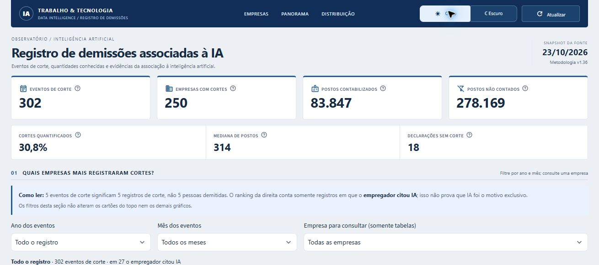
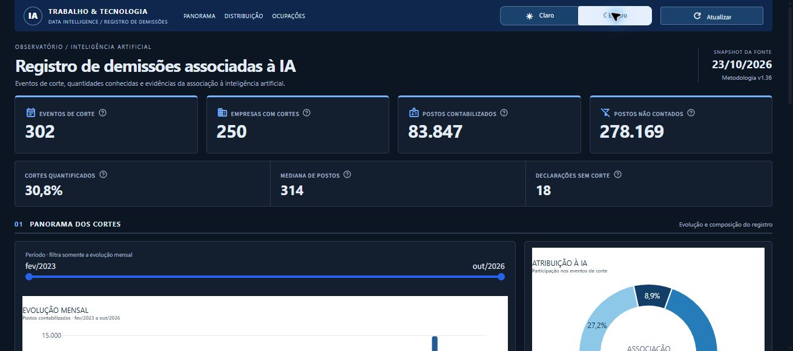
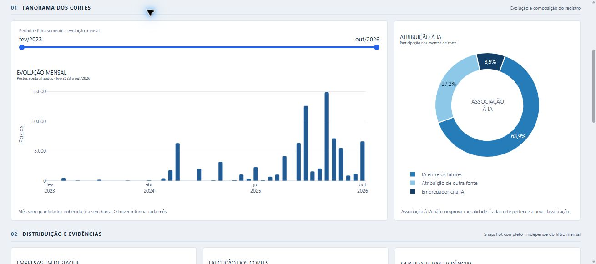
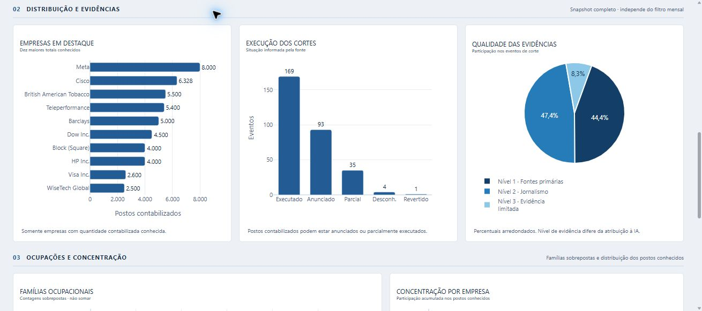
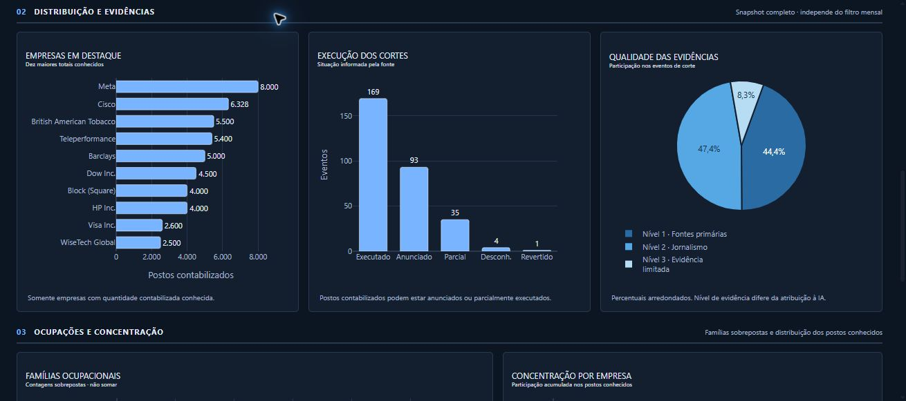

# Registro de demissões associadas à IA

Projeto acadêmico independente sobre eventos de cortes associados à IA. Python/uv e DuckDB fazem a carga em três camadas; cada indicador é definido em SQL. O roteiro e os contratos completos estão em [doc.md](doc.md).

## Fonte e licença

- [AI Layoffs Register no Kaggle](https://www.kaggle.com/datasets/ailayoffs/ai-layoffs-register-2023-2026-every-row-sourced), publicado pelo **AI Layoffs Index**.
- Snapshot: **23/10/2026**, metodologia **1.36**. Essa metodologia não é a versão numérica do Kaggle.
- [Licença recebida](fontes/LICENSE_dataset.txt) e [página canônica](https://ailayoffs.org/license): AI Layoffs Index and Register: Data License, com permissão para redistribuir o registro e produzir análises, mediante atribuição ao publicador e às fontes dos eventos. Não é uma licença Creative Commons.
- [README original](fontes/README_dataset.md), [proveniência e hash](fontes/proveniencia.json) e [perfil da cópia](fontes/perfil_fonte.json).

O CSV recebido acompanha `raw/` sem edição. Para citar um evento, preservar seu identificador e link de fonte. Esta análise não é uma leitura oficial do índice e não implica endosso do publicador. As URLs não concedem permissão para redistribuir os artigos de terceiros.

## Perguntas e modelo

O projeto responde como evoluem os cortes por mês, quais empresas têm mais postos contabilizados, como os eventos se distribuem por atribuição, execução e evidência, quais famílias aparecem e como os postos conhecidos se concentram entre empresas.

| Camada / tabela | O que uma linha representa |
|---|---|
| `raw.eventos` | Registro exatamente como recebido no CSV, com campos textuais |
| `refined.eventos` | Evento tipado, identificado por `evento_id` |
| `refined.evento_familia` | Par único `evento_id` + `familia_ocupacional` |
| `marts.*` | Indicador no grão declarado no respectivo arquivo SQL |

As duas tabelas refined têm relação de um evento para várias famílias. O indicador de famílias usa JOIN por `evento_id`, conta eventos distintos e não soma postos depois da expansão. A normalização existe porque uma lista multivalorada não tem o mesmo grão de um evento; a associação guarda só a chave e a família.

## Estado da construção

- **A — fonte e pergunta:** cópia preservada, licença conferida e perfil registrado. Há 320 eventos e 498 pares evento–família, cobrindo os mesmos 320 IDs sem órfãos na derivação diagnóstica. Esses valores não são expectativas dos testes unitários.
- **B — ambiente:** Python 3.14.3, DuckDB 2.0.0, pandas 3.1.0, Streamlit 1.66.1 e Plotly 7.1.0 disponíveis. pytest-cov acrescentado; coleta em `test/`, cobertura total mínima de 60% e Ruff configurados.
- **C — infraestrutura e ingestão:** 12 testes sintéticos aprovados; carga real conferida com 320 linhas em `raw.eventos`.
- **D — transformação:** seis novos testes aprovados, incluindo conflito, conversões, vazio e rollback tardio. Cópia real: 320 eventos e 498 associações, com zero órfãos; quantidades ausentes preservadas.
- **E — indicadores SQL:** oito marts e seis novos testes aprovados. Cópia real: 402 linhas materializadas; o JOIN de cortes tem 475 associações para 302 IDs distintos. Totais mensal e por empresa reconciliam em 83.847 postos contabilizados.
- **F1 — biblioteca de apresentação:** `painel.py` entregue com sete cartões, sete figuras e 11 testes aprovados. Sem Streamlit ou agregações de negócio; leitura read-only curta e figuras sem mutação dos dados.
- **F2 — app:** sete cartões/figuras, cache, recarga e filtro mensal verificados com Streamlit AppTest. Disposição conferida no Chrome em largura normal e 768 px; cartões e gráficos se reorganizam na tela menor.
- **F3 — HTML:** sete testes aprovados, mesmas figuras/cartões, IDs fixos, CDN único e determinismo do rodapé. Arquivo real gerado com 67,8 KB. A abertura automática de `file://` foi bloqueada pela política do navegador da ferramenta; conferir visualmente com dois cliques ainda é uma verificação manual pendente.
- **G — validação automatizada e reprodução:** 42 testes aprovados, cobertura de 98,65%, Ruff aprovado e reconstrução completa em clone limpo. Os testes também passaram com o CSV ocultado e sem banco do projeto. Evidências em [validacao_entrega.json](fontes/validacao_entrega.json). Permanece apenas a conferência visual manual do HTML local, descrita acima.
- **H — modernização visual:** temas claro e escuro, cartões com ícones, seções e grade adaptável. 44 testes aprovados, cobertura de 97,97%, AppTest e leitura visual no Chrome em 1310 e 390 px. Evidências em [validacao_visual.json](fontes/validacao_visual.json); o registro da etapa G permanece como histórico anterior à modernização.
- **I — reformulação conforme a referência:** cabeçalho compacto, grade assimétrica, quatro gráficos de barras, uma rosca, uma pizza, curva com área e tabela. 46 testes aprovados e conferência de temas, navegação e celular; [registro da revisão 2](fontes/validacao_design_v2.json). Os registros G e H são históricos.

## Preparar o ambiente

Pré-requisitos: Git, uv e Python compatível com `requires-python` no `pyproject.toml`. O uv pode obter o interpretador necessário.

```powershell
git clone https://github.com/adrianobuilder/demissoes_ia.git
cd demissoes_ia
uv sync --locked
```

O nome da pasta clonada pode diferir de `demissao_ia`; os caminhos de produção serão baseados na localização dos módulos. Os arquivos de entrada estão versionados. `.gitattributes` preserva os bytes do CSV e dos documentos originais, inclusive no Windows.

Para reproduzir do zero, execute na pasta clonada:

```powershell
uv run pytest --cov
uv run python -m pipeline.ingestao
uv run python -m pipeline.transformacao
uv run python -m pipeline.marts
uv run python relatorio.py
```

Não é necessário KaggleHub, credencial Kaggle ou download adicional do CSV. `uv sync --locked` usa o lock versionado; a instalação de pacotes pode precisar de internet. Os testes podem rodar antes da carga: usam só dados inventados e bancos temporários.

Para abrir o dashboard, depois da carga:

```powershell
uv run streamlit run app.py
```

Cada etapa substitui seus destinos, sem acumular linhas. Ingestão, transformação e reconstrução dos marts têm transações próprias: uma falha preserva o estado anterior daquela etapa, não desfaz etapas anteriores já concluídas. No executor de marts, qualquer SQL inválido ou sem linhas reverte a reconstrução inteira. As mensagens informam o erro; não considerar a carga atualizada após uma falha.

`refined.eventos` preserva o texto original de famílias. `refined.evento_familia` contém apenas as duas colunas da associação, sem replicar a quantidade de postos. Os dois destinos são substituídos na mesma transação; uma falha preserva ambos. Identificadores conflitantes causam erro em vez de escolher uma versão arbitrária. Vazios viram nulos em refined, enquanto `NA` continua texto válido.

## Indicadores e SQL de origem

| Pergunta / indicador | SQL | Grão |
|---|---|---|
| Evolução dos cortes e postos conhecidos | [01_cortes_mensais.sql](sql/marts/01_cortes_mensais.sql) | Mês; inclui calendário e lacunas |
| Sete cartões: cortes, empresas, dois totais de postos separados, cobertura, mediana e declarações | [02_kpis.sql](sql/marts/02_kpis.sql) | Snapshot inteiro, uma linha |
| Empresas com cortes e postos conhecidos | [03_empresas.sql](sql/marts/03_empresas.sql) | Empresa informada |
| Atribuição à IA | [04_atribuicao_ia.sql](sql/marts/04_atribuicao_ia.sql) | Atribuição entre cortes |
| Situação de execução | [05_execucao_cortes.sql](sql/marts/05_execucao_cortes.sql) | Situação entre cortes |
| Nível de evidência | [06_evidencias.sql](sql/marts/06_evidencias.sql) | Nível entre cortes |
| Famílias ocupacionais, usando JOIN | [07_familias_ocupacionais.sql](sql/marts/07_familias_ocupacionais.sql) | Família; eventos distintos e não aditivos |
| Concentração de postos conhecidos | [08_concentracao_empresas.sql](sql/marts/08_concentracao_empresas.sql) | Empresa; acumulado com desempate |

Na cópia real, os cartões retornam 302 cortes, 250 empresas, 83.847 postos contabilizados, 278.169 reportados não contabilizados nos cortes, 30,8% de cobertura, mediana 314 e 18 declarações. Esses valores são diagnóstico do snapshot, não expectativas da suíte unitária.

## Dashboard

```powershell
uv run streamlit run app.py
```

Abrir o endereço mostrado pelo Streamlit. Use **Claro / Escuro** no topo para alternar a aparência da página e dos gráficos. A escolha permanece durante os filtros e a atualização de dados na mesma sessão. O padrão é claro.

O desenho segue o painel financeiro de referência: cabeçalho compacto azul-marinho, navegação por seções, quatro cartões principais e três medidas numa faixa complementar. As quatro faixas são: indicadores; barras mensais e rosca de atribuição; barras de empresas/execução e pizza de evidências; barras de famílias e curva de concentração com tabela de empresas. Abaixo de 950 px, cartões principais passam a duas colunas e os gráficos se empilham. As definições ficam na ajuda dos cartões e em **Metodologia e como interpretar os indicadores**. As [decisões visuais](design/visual.md) mostram a composição e o vínculo entre cada figura e seu mart.

O filtro altera apenas o gráfico mensal; cartões e comparações mantêm o snapshot completo. `Atualizar` descarta o cache e relê os marts, fechando a conexão antes de renderizar. Reconstruir o pipeline não atualiza automaticamente os DataFrames já cacheados; o botão não baixa outra versão do dataset. As pizzas representam categorias exclusivas; famílias ocupacionais se sobrepõem e continuam em barras. Percentuais arredondados podem somar 100,1%.

| Claro | Escuro |
|---|---|
|  |  |



| Gráficos no claro | Gráficos no escuro |
|---|---|
|  |  |

## Relatório HTML

```powershell
uv run python relatorio.py
uv run pytest test/test_relatorio.py
```

O comando imprime o caminho e o tamanho de `relatorio.html`, gerado na raiz. Abrir o arquivo com dois cliques. Ele contém o período padrão completo, sem filtro; a biblioteca Plotly vem do CDN e precisa de internet. O rodapé registra a geração em `America/Sao_Paulo`, separadamente do snapshot da fonte. Banco e HTML gerados não são versionados; os comandos os reconstroem.

## Verificações e resultados

```powershell
uv run pytest --cov
uv run ruff check pipeline painel.py app.py relatorio.py test
uv run ruff format --check pipeline painel.py app.py relatorio.py test
git log --oneline --graph --all
```

Resultado após a revisão 2, em 30/10/2026: **46 testes em seis arquivos, 97,62% de cobertura total**, 420 instruções e dez não executadas. A meta é 60%. Quatro linhas ausentes são chamadas sob `if __name__ == '__main__'`; os respectivos `main()` são testados diretamente. Uma é o erro defensivo para associações órfãs; três montam o CSS local, conferido no app; duas adicionam ao hover de barras um percentual opcional que os marts atuais de empresa/família não fornecem. Uma sonda temporária criada na etapa G confirmou que um módulo não importado aparece com 0%; a sonda foi removida e não integra o projeto. `app.py` e a UI opcional ficam fora do percentual; o app teve verificação funcional e visual separada.

O AppTest confirmou os sete valores, os tipos de gráficos previstos, dados e percentuais iguais nos dois temas, tabela presente, alteração só do mensal pelo filtro e manutenção do tema após recarga. O Chrome mostrou a grade, textos, navegação e gráficos nos dois temas; em 390 px, verificou-se o empilhamento, legendas e datas sem sobreposição. Os textos percentuais nas pizzas têm contraste de pelo menos 4,5:1 nas cores atuais. O relatório usa as mesmas figuras e tabela no tema claro, com 72,6 KB; os sete testes do HTML continuam aprovados. Esta revisão não repetiu o clone limpo: a reprodução abaixo registra a etapa G, anterior às mudanças visuais.

O clone limpo do repositório reproduziu os 42 testes sem o CSV disponível e sem banco de produção. Após restaurar a entrada, os três comandos reconstruíram 320 eventos, 498 associações e oito marts, com 402 linhas no total. Duas gerações reais do HTML mantiveram conteúdo igual, exceto pelo horário previsto; o arquivo tem 69.441 bytes. O SHA-256 do CSV foi conferido na cópia, no objeto Git e no clone. O AppTest também verificou banco ausente: mensagem de orientação, sem criar arquivo ou exibir um painel parcial.

O [repositório pessoal público](https://github.com/adrianobuilder/demissoes_ia) foi conferido como não sendo fork. Cada etapa foi construída e enviada em um commit próprio. Um merge preservou tanto o commit inicial remoto quanto o histórico local, sem reescrita. O link do repositório é a entrega acadêmica; o envio pela plataforma da aula cabe ao aluno.

## Limites de interpretação

Eventos de corte e declarações sem corte são populações diferentes. Postos contabilizados e postos reportados não contabilizados não são somados. Ausência de quantidade não equivale a zero. Associação à IA não comprova causalidade; postos contabilizados também podem pertencer a anúncios ou execução parcial. País é um campo livre que pode descrever sede, local dos postos ou escopo global; setor também não é uma classificação padronizada. Esses campos foram preservados, sem rankings geográficos ou setoriais no primeiro painel. Não houve auditoria independente de todas as notícias ligadas pelo registro. O ano de 2026 termina em outubro nesta cópia.

## Uso da IA: conferências e correções

Na apresentação, os testes funcionais não detectaram truncamento dos cartões numa tela de 768 px. A conferência no Chrome revelou o problema; a grade passou a reorganizar os cartões e empilhar os gráficos nessa largura, preservando as medidas e as quatro faixas lógicas. A verificação visual complementa os testes, sem ser substituída pela cobertura.

Na modernização, sete cartões lado a lado cortaram um valor no desktop. A grade foi corrigida para quatro e três. Na tela de 390 px, rótulos e datas também ficaram apertados: os ícones decorativos são ocultados nessa largura, os textos podem quebrar sem truncamento e o eixo mensal mostra até quatro datas. Os pontos mensais, as lacunas e os valores foram preservados; o hover continua mostrando cada mês.

O usuário apontou que essa primeira modernização ainda não seguia a referência: mudava sobretudo cores e cartões, mantendo os mesmos tipos de gráficos. A revisão 2 mudou a composição, adotou colunas, rosca, pizza e tabela e preservou as medidas SQL. A inspeção visual também encontrou pouco contraste no botão selecionado e rótulos de execução apertados; o contraste foi corrigido e “Desconhecido” é abreviado só no eixo, com nome completo no hover.

Na primeira execução da etapa C, 4 de 12 testes falharam: o código gerado usou `fetchone()` na contagem e tentou desregistrar o DataFrame com um resultado ainda pendente no DuckDB 2.0. A exceção `ResourceInUseException` mostrou a suposição incorreta de compatibilidade com a versão anterior. A correção passou a consumir todo o resultado com `fetchall()` antes de `unregister`; os 12 testes passaram na repetição, incluindo gravação, reexecução, entrada vazia e rollback. A [documentação da API Python](https://www.duckdb.org/docs/lts/clients/python/dbapi) também descreve a necessidade de concluir o resultado antes de outra operação na conexão.

Na preparação do guia, o total reportado exigiu revisão da população: todas as linhas somam 285.969, mas uma declaração sem corte contém 7.800. A conferência por tipo de evento determinou 278.169 para o indicador restrito aos cortes. O diagnóstico ficou registrado em `fontes/perfil_fonte.json`; os testes usam exemplos inventados para verificar essa separação.

O desenho inicial usava uma CTE para famílias. O requisito adicional de duas tabelas relacionadas levou à tabela física `evento_familia`; essa é uma adaptação ao desafio, não uma segunda fonte independente.
