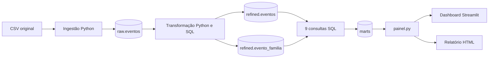
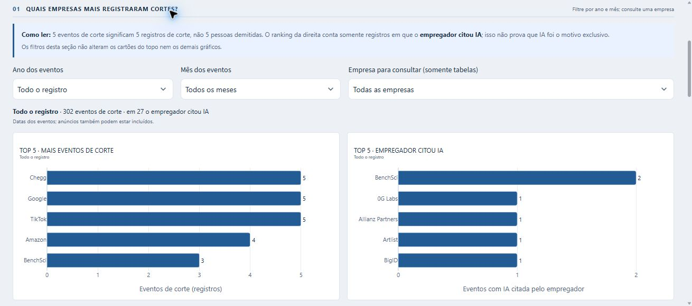

# Registro de demissões associadas à IA

Pipeline acadêmico de engenharia de dados que transforma um CSV do Kaggle em indicadores SQL, dashboard e relatório HTML. O objetivo é entender **quais empresas registram mais eventos de corte em cada período, quais vínculos com IA foram informados e quantos postos têm quantidade conhecida**.

Um evento de corte é um registro, não uma pessoa demitida. A associação com IA segue a classificação da fonte e não comprova causa exclusiva. A seção [Atribuição à IA e confiabilidade](#atribuição-à-ia-e-confiabilidade) explica os critérios e seus limites. IA é o tema dos dados e apoiou o desenvolvimento; o pipeline é executado com Python e SQL.

**Estado atual:** três camadas, duas tabelas relacionadas em refined, nove marts, sete cartões, nove gráficos, temas claro/escuro e relatório reproduzível. **55 testes aprovados; 97,89% de cobertura** na revisão de 03/11/2026.


## Navegação

- [Fonte e licenças](#fonte-e-licenças)
- [Atribuição à IA e confiabilidade](#atribuição-à-ia-e-confiabilidade)
- [Linguagens, bibliotecas e ferramentas](#linguagens-bibliotecas-e-ferramentas)
- [Estrutura do projeto](#estrutura-do-projeto)
- [Arquitetura e regras dos dados](#arquitetura-e-regras-dos-dados)
- [Como executar do zero](#como-executar-do-zero)
- [Indicadores e SQL de origem](#indicadores-e-sql-de-origem)
- [Dashboard e relatório](#dashboard-e-relatório)
- [Testes e validação](#testes-e-validação)
- [Requisitos da entrega acadêmica](#requisitos-da-entrega-acadêmica)
- [Problemas comuns](#problemas-comuns)
- [Limitações e pendências](#limitações-e-pendências)
- [Autoria e contribuições](#autoria-e-contribuições)
- [Uso da IA](#uso-da-ia)

## Fonte e licenças

| Informação | Valor |
|---|---|
| Dataset | [AI Layoffs Register no Kaggle](https://www.kaggle.com/datasets/ailayoffs/ai-layoffs-register-2023-2026-every-row-sourced) |
| Publicador | AI Layoffs Index |
| Arquivo de entrada | [raw/ai-layoffs-register.csv](raw/ai-layoffs-register.csv) |
| Snapshot da fonte | 23/10/2026 |
| Metodologia | 1.36; não é a versão numérica do Kaggle |
| Eventos da cópia | 320: 302 cortes e 18 declarações sem corte discreto |
| Intervalo dos eventos | 22/02/2023 a 22/10/2026 |
| Proveniência | [Metadados e SHA-256](fontes/proveniencia.json), [perfil dos dados](docs/perfil_fonte.json) |

O CSV acompanha o repositório sem edição. A [licença recebida do dataset](fontes/LICENSE_dataset.txt), **AI Layoffs Index and Register: Data License**, permite redistribuição e análises com atribuição ao publicador e às fontes dos eventos. Preservar os termos, a data e a metodologia; não rotular essa licença como Creative Commons. Consulte também o [README original](fontes/README_dataset.md) e a [página da licença](https://ailayoffs.org/license).

Esta análise é independente e não implica endosso do publicador. As URLs dos eventos identificam suas fontes; a licença do registro não autoriza redistribuir os artigos de terceiros.

**Licença do código:** ainda não há um arquivo `LICENSE` próprio para o código. A escolha e inclusão dessa licença permanecem pendentes; a licença acima documenta o dataset.

## Atribuição à IA e confiabilidade

**Quem atribui:** o publicador AI Layoffs Index classifica os eventos a partir de documentos das empresas e reportagens. Este projeto importa a coluna `Attribution` do CSV para `refined.eventos.atribuicao_ia`, valida os rótulos permitidos e preserva a classificação recebida. Não usa um modelo de IA, palavras-chave ou inferência própria para decidir se uma demissão foi causada por IA. Os critérios abaixo vêm do [dicionário e método da cópia recebida, versão 1.36](fontes/README_dataset.md#method-in-brief).

| Categoria da fonte | Critério de atribuição | O que permite afirmar |
|---|---|---|
| `explicit` | O próprio empregador aponta IA como causa do corte. | Há uma declaração do empregador vinculando o corte à IA; isso não demonstra que IA foi a única causa. |
| `mixed` | O empregador cita IA entre outros fatores, como eficiência ou reestruturação. | Há uma associação declarada, sem determinar quantos postos decorrem especificamente da IA. |
| `blamed` | Outra fonte atribui o corte à IA, mas o empregador não faz essa atribuição ou nega o vínculo. | Há uma alegação externa registrada; não há confirmação do empregador. A quantidade não entra em `Roles counted`. |

**Quando uma quantidade é contabilizada:** segundo o publicador, o empregador precisa vincular o corte à IA (`explicit` ou `mixed`) e colocar a quantidade em registro público, como documento, comunicado, fala de executivo identificado ou porta-voz. Intervalos usam o limite inferior; percentuais exigem uma base de funcionários publicada pelo empregador; um quadro planejado antes/depois permite calcular a diferença. Uma negativa de que IA motivou o corte impede a contagem, mesmo com declarações conflitantes. Números apenas reportados, tetos de “até”, redução por saída voluntária e quantidades que incluem postos transferidos ficam de fora, com justificativa em `Why not counted`.

O pipeline preserva as quantidades e justificativas do CSV; não recalcula nem audita esses critérios nas fontes dos eventos. Estar em `explicit` ou `mixed` não garante que exista uma quantidade contabilizada. `Roles reported (not counted)` fica separado de `Roles counted`, e `Execution` informa se o corte foi anunciado, executado, parcial, revertido ou tem situação desconhecida. Uma quantidade contabilizada pode corresponder a um anúncio ainda não executado.

**Qual é a força da evidência:** `Evidence tier`, preservado em `nivel_evidencia`, descreve a origem do suporte à atribuição, separadamente da categoria acima:

| Nível | Suporte informado pela fonte | Limite de interpretação |
|---|---|---|
| `Tier 1` | Documento primário ou declaração da própria empresa. | Permite verificar o que a empresa declarou; a declaração não comprova causalidade por si só. |
| `Tier 2` | Reportagem identificada e considerada confiável pelo publicador. | Depende da apuração e da interpretação dessa reportagem. |
| `Tier 3` | Sinal mais fraco ou de uma única fonte. | Exige maior cautela e conferência do material citado. |

**Não há uma taxa de acerto ou probabilidade de causalidade medida neste projeto.** Não houve auditoria independente de todos os artigos nem comparação com uma base de referência para medir erros de classificação. Os níveis são qualitativos, não percentuais de confiança. Testes e cobertura verificam o processamento dos dados, não a veracidade das alegações. O registro também depende do que foi divulgado e encontrado pelo publicador; não representa todas as demissões nem permite estimar o efeito causal da IA no emprego.

**Como ler os resultados desta cópia:** entre os **302 cortes**, há **27 `explicit`, 193 `mixed` e 82 `blamed`**; os 18 registros `workforce statement` ficam fora dessa população. Os níveis de evidência entre cortes são 134 `Tier 1`, 143 `Tier 2` e 25 `Tier 3`. O [mart de atribuição](sql/marts/04_atribuicao_ia.sql) inclui as três categorias como eventos registrados, enquanto o ranking **Empregador citou IA** do [mart por período](sql/marts/09_empresas_periodo.sql) usa apenas `explicit`. Embora `mixed` também cite IA, ele aparece separadamente como IA entre fatores. Assim, o total de 302 não significa 302 cortes confirmados pelo empregador como causados por IA, e os 83.847 postos contabilizados não medem postos comprovadamente substituídos por IA.

Para conferir um caso, consulte `fonte_url`, `descricao_evento`, `posicao_empregador`, `motivo_nao_contabilizado`, `nivel_evidencia` e `situacao_execucao` em `refined.eventos`, identificando-o por `evento_id`. Esses campos permitem rastrear a alegação até a fonte citada.

## Linguagens, bibliotecas e ferramentas

| Tecnologia | Versão verificada | Como é utilizada |
|---|---|---|
| Python | 3.14.3; projeto exige `>=3.14` | Pipeline, validações, apresentação e testes |
| SQL, dialeto DuckDB | DuckDB 2.0.0 | Conversões, agregações, JOIN, calendário, janelas e rankings |
| HTML e CSS | Arquivos locais | Cartões, tabelas, temas e relatório em arquivo único |
| pandas | 3.1.0 | Leitura textual do CSV e DataFrames; seleção e formatação na apresentação |
| Plotly | 7.1.0 | Barras, rosca, pizza, curva e exportação interativa para HTML |
| Streamlit | 1.66.1 | Dashboard, cache de dados, filtros, temas e recarga |
| pytest | 9.2.0 | Testes com dados inventados e bancos temporários |
| pytest-cov / coverage | 7.1.0 / 7.17.0 | Cobertura de linhas, com mínimo total de 60% |
| Ruff | 0.17.3 | Análise estática e formatação |
| uv | 0.11.18 | Ambiente virtual, dependências e execução dos comandos |
| Git / GitHub | Git 2.56.0 no ambiente verificado | Histórico de commits por etapa e repositório pessoal público |

As dependências diretas estão em [pyproject.toml](pyproject.toml); o [uv.lock](uv.lock) fixa as versões resolvidas, incluindo as transitivas. `uv sync --locked` também instala o grupo de desenvolvimento usado nos testes. Os módulos da biblioteca padrão, como `pathlib`, `csv`, `datetime`, `html` e `zoneinfo`, não exigem instalação separada.

O banco é um arquivo DuckDB local; não é necessário instalar um servidor de banco. O snapshot versionado dispensa KaggleHub, credenciais Kaggle e novo download para reproduzir esta entrega.

## Estrutura do projeto

```text
demissoes_ia/
├── README.md                         # Apresentação, execução e resultados
├── doc.md                            # Guia completo e contratos do projeto
├── pyproject.toml                    # Dependências e configuração das verificações
├── uv.lock                           # Versões resolvidas
├── .gitignore                        # Exclui ambiente, banco, HTML e caches gerados
├── .gitattributes                    # Preserva os bytes dos arquivos originais
├── .streamlit/config.toml            # Configuração inicial do Streamlit
├── raw/
│   └── ai-layoffs-register.csv       # Entrada original versionada
├── pipeline/
│   ├── __init__.py
│   ├── db.py                        # Caminhos, conexões e escrita no DuckDB
│   ├── ingestao.py                  # CSV → raw.eventos
│   ├── transformacao.py             # Raw → eventos tipados e associação de famílias
│   └── marts.py                     # Executa os SQLs e materializa os indicadores
├── sql/marts/
│   ├── 01_cortes_mensais.sql
│   ├── 02_kpis.sql
│   ├── 03_empresas.sql
│   ├── 04_atribuicao_ia.sql
│   ├── 05_execucao_cortes.sql
│   ├── 06_evidencias.sql
│   ├── 07_familias_ocupacionais.sql
│   ├── 08_concentracao_empresas.sql
│   └── 09_empresas_periodo.sql
├── painel.py                        # Leitura dos marts, formatação, figuras e tabelas
├── app.py                           # Interface Streamlit
├── relatorio.py                     # Geração do relatório HTML
├── test/
│   ├── test_db.py
│   ├── test_ingestao.py
│   ├── test_transformacao.py
│   ├── test_marts.py
│   ├── test_painel.py
│   └── test_relatorio.py
├── fontes/
│   ├── README_dataset.md            # Documentação original da fonte
│   ├── LICENSE_dataset.txt          # Licença do dataset
│   └── proveniencia.json            # Snapshot, metodologia e hash usados pelo painel
├── docs/
│   ├── perfil_fonte.json            # Diagnóstico inicial da cópia
│   └── validacoes/                  # Evidências históricas do processo de entrega
│       └── validacao_*.json
└── design/
    ├── visual.md                    # Decisões de composição e responsividade
    ├── painel.css                   # Estilos e temas
    └── *.jpg                        # Capturas reais do dashboard
```

Arquivos **gerados e não versionados**: `.venv/`, `demissao_ia.duckdb`, `relatorio.html`, `.coverage` e caches. O nome da pasta local pode variar; os caminhos dos dados são definidos em [pipeline/db.py](pipeline/db.py) a partir da raiz do projeto. As specs dos módulos ficam em suas docstrings; [doc.md](doc.md) reúne as decisões e contratos completos.

`fontes/` reúne a documentação, a licença e a proveniência do dataset. Diagnósticos e registros de validação ficam em `docs/`; são evidências do processo e não são entradas do pipeline, do painel ou do relatório.

## Arquitetura e regras dos dados



| Camada / tabela | O que representa uma linha | Linhas nesta cópia |
|---|---|---:|
| `raw.eventos` | Registro original, com as 20 colunas textuais e duplicatas preservadas | 320 |
| `refined.eventos` | Evento tipado, identificado por `evento_id` | 320 |
| `refined.evento_familia` | Par único `evento_id` + `familia_ocupacional` | 498 |
| `marts.*` | Indicador no grão declarado no respectivo SQL | 1.241 no conjunto dos nove marts |

As duas tabelas refined se relacionam por `evento_id`, em uma relação de um evento para várias famílias. [07_familias_ocupacionais.sql](sql/marts/07_familias_ocupacionais.sql) usa esse JOIN e conta eventos distintos. Não copia postos para cada associação nem os soma depois da expansão. As 1.241 linhas dos marts misturam grãos diferentes e não representam 1.241 eventos.

As principais decisões de tratamento são:

- **Raw preservada:** CSV lido como texto, sem converter vazios em marcadores automáticos; `.gitattributes` preserva os bytes da entrada.
- **Tipos e campos obrigatórios:** datas ISO, quantidades inteiras não negativas, booleanos `yes/no` e validação de ID, empresa, data e tipo do evento.
- **Duplicatas e conflitos:** somente duplicatas integrais após conversão são removidas; versões conflitantes do mesmo ID interrompem a transformação.
- **Ausências:** vazios viram nulos em refined; uma quantidade desconhecida não vira zero. `NA` continua texto válido.
- **Populações:** `cut` identifica eventos de corte; `workforce statement` é declaração sem corte discreto e não entra nos rankings de cortes.
- **Medidas em SQL:** agregações, percentuais, JOIN e posições são calculados nos marts. A apresentação seleciona, ordena e formata os resultados.
- **Reexecução:** as etapas substituem seus destinos, sem acumular linhas. Cada etapa tem sua própria transação; uma falha preserva o estado anterior daquela etapa.

No executor de marts, SQL inválido ou resultado sem linhas reverte a reconstrução de todos os marts. Uma falha posterior não desfaz etapas anteriores já concluídas. As mensagens de sucesso e as contagens só são impressas após o commit da etapa.

## Como executar do zero

Pré-requisitos: **Git e uv instalados**, acesso à internet para instalar dependências e Python compatível com `>=3.14`. O uv pode obter o interpretador necessário. Ambiente verificado: Windows/PowerShell, Python 3.14.3 e uv 0.11.18.

Execute os comandos abaixo na ordem. Se uma etapa falhar, corrija o erro antes de continuar.

```powershell
git clone https://github.com/adrianobuilder/demissoes_ia.git
cd demissoes_ia
uv sync --locked

uv run pytest --cov
uv run python -m pipeline.ingestao
uv run python -m pipeline.transformacao
uv run python -m pipeline.marts
uv run python relatorio.py
```

Os testes podem rodar antes da carga: usam dados inventados e bancos temporários, sem abrir o banco do projeto. Não é necessário configurar variáveis de ambiente ou tokens para essa execução.

| Resultado esperado | Onde fica |
|---|---|
| 320 registros brutos, 320 eventos tipados e 498 associações de famílias | Schemas `raw` e `refined` em `demissao_ia.duckdb` |
| Nove marts, com 1.241 linhas materializadas | Schema `marts` no mesmo arquivo |
| Relatório estático com sete cartões e nove figuras | `relatorio.html`, na raiz |

Essas contagens descrevem o snapshot versionado, não um limite fixo para futuras fontes. A carga não busca atualizações no Kaggle. Uma nova cópia exige conferir licença, esquema, proveniência e contagens antes de atualizar o CSV versionado.

## Consultar o banco no navegador

Na raiz do projeto, depois da carga, execute `uv run python -X utf8`. No prompt Python (`>>>`), execute uma linha por vez:

```python
import duckdb

con = duckdb.connect()
con.execute("ATTACH 'demissao_ia.duckdb' AS projeto (READ_ONLY)")
con.execute("INSTALL ui")
con.execute("LOAD ui")
con.execute("CALL start_ui()")
```

Abra **http://localhost:4213** e mantenha esse terminal aberto. A instalação da extensão e o carregamento da interface precisam de internet. O banco do projeto fica conectado em leitura; a interface usa uma conexão principal em memória. Consulte a [documentação oficial da extensão UI](https://duckdb.org/docs/stable/core_extensions/ui).

**Em cada célula SQL, selecione `projeto` no seletor de banco ao lado de Run.** Uma célula configurada como `memory` não encontra `refined.eventos`, mesmo que o banco apareça na barra lateral. Com `projeto` selecionado, os nove arquivos de `sql/marts/` podem ser executados sem alterações.

Também é possível indicar explicitamente banco, schema e tabela, independentemente do seletor:

```sql
SELECT count(*) AS total_eventos FROM projeto.refined.eventos;
-- Esperado nesta cópia: 320

SELECT * FROM projeto.marts.kpis;
```

Para encerrar a interface, execute `con.close()` e `exit()` no terminal Python. Feche essa conexão antes de reconstruir as camadas, para liberar o arquivo para gravação. As consultas da Olist usam outro banco e outras tabelas; não pertencem a este projeto.

## Indicadores e SQL de origem

| Pergunta / indicador | SQL | Grão |
|---|---|---|
| Evolução dos cortes e postos conhecidos | [01_cortes_mensais.sql](sql/marts/01_cortes_mensais.sql) | Mês, com calendário e lacunas |
| Sete cartões do registro | [02_kpis.sql](sql/marts/02_kpis.sql) | Snapshot inteiro, uma linha |
| Eventos e postos por empresa | [03_empresas.sql](sql/marts/03_empresas.sql) | Nome de empresa informado |
| Vínculo dos cortes com IA | [04_atribuicao_ia.sql](sql/marts/04_atribuicao_ia.sql) | Atribuição entre cortes |
| Situação de execução | [05_execucao_cortes.sql](sql/marts/05_execucao_cortes.sql) | Situação entre cortes |
| Nível de evidência | [06_evidencias.sql](sql/marts/06_evidencias.sql) | Nível entre cortes |
| Famílias ocupacionais, usando JOIN | [07_familias_ocupacionais.sql](sql/marts/07_familias_ocupacionais.sql) | Família; contagens não aditivas |
| Concentração de postos conhecidos | [08_concentracao_empresas.sql](sql/marts/08_concentracao_empresas.sql) | Empresa, com acumulado e desempate |
| Eventos e IA citada pelo empregador por ano/mês | [09_empresas_periodo.sql](sql/marts/09_empresas_periodo.sql) | Empresa + nível total/ano/mês + início do período |

Os sete cartões desta cópia mostram **302 eventos de corte, 250 empresas, 83.847 postos contabilizados, 278.169 reportados não contabilizados, 30,8% de cortes quantificados, mediana de 314 postos e 18 declarações sem corte**. A mediana considera somente eventos com quantidade contabilizada conhecida. Os dois campos de postos não devem ser somados.

## Dashboard e relatório

Para abrir o dashboard depois da carga:

```powershell
uv run streamlit run app.py
```

Abra o endereço informado pelo Streamlit. O cabeçalho reúne navegação centralizada, seletor **Claro / Escuro** e **Atualizar**. A escolha do tema permanece durante filtros e recarga na mesma sessão. A composição tem cinco faixas: indicadores, empresas por período, panorama mensal, distribuição/evidências e ocupações/concentração. Consulte as [decisões visuais](design/visual.md).



Os controles têm escopos separados:

- **Ano e mês dos eventos:** alteram os dois rankings e as tabelas da seção de empresas. O mês exige selecionar um ano.
- **Empresa para consultar:** filtra somente as tabelas; o ranking geral do período permanece. As abas mostram resumo e meses com eventos registrados.
- **Período da evolução mensal:** altera somente o gráfico mensal de postos.
- **Cartões e outras seis comparações:** mantêm o registro completo, independentemente desses filtros.
- **Atualizar:** limpa o cache e relê os marts materializados; não baixa outra versão do dataset nem executa o pipeline.

O ranking de todos os eventos inclui empresas sem quantidade conhecida de postos. O ranking **Empregador citou IA** usa somente a categoria `explicit`. `mixed` indica IA entre vários fatores e `blamed`, associação por outra fonte. Empates são ordenados pelo nome; os gráficos exibem até cinco empresas e a tabela permite consultar as demais. O SQL materializa níveis total, ano e mês: **não somar esses níveis entre si**.

Para gerar somente o relatório:

```powershell
uv run python relatorio.py
```

O comando imprime caminho e tamanho. Abra `relatorio.html` com dois cliques. Ele usa as mesmas figuras e o período completo, sem filtros interativos. Tem IDs fixos `g01` a `g09`, Plotly pelo CDN uma única vez e tamanho inferior a 200 KB. Precisa de internet para carregar a biblioteca dos gráficos. O rodapé registra a geração em `America/Sao_Paulo`, separadamente do snapshot; o arquivo não consulta o banco. Com o mesmo dado e ambiente, duas gerações mudam apenas a data/hora do rodapé.

## Testes e validação

```powershell
uv run pytest --cov
uv run ruff check pipeline painel.py app.py relatorio.py test
uv run ruff format --check pipeline painel.py app.py relatorio.py test
```

| Arquivo de testes | O que verifica |
|---|---|
| `test_db.py` | Caminhos, identificadores, conexões e gravação |
| `test_ingestao.py` | CSV textual, cabeçalho, entrada vazia, reexecução e rollback |
| `test_transformacao.py` | Tipos, obrigatoriedade, nulos, conflitos, duplicatas e famílias |
| `test_marts.py` | Executor, nove SQLs, JOIN, calendário, percentuais, períodos, rankings e rollback |
| `test_painel.py` | Formatação, leitura curta, figuras, temas, filtros, tabelas, escape e ausência de agregações |
| `test_relatorio.py` | Reutilização das nove figuras, cartões, faixas, IDs, CDN, tamanho, escape e determinismo |

Em **30/10/2026**, os comandos acima e a sequência completa de carga foram reproduzidos em clone limpo do commit `89a8dd0`, sem banco anterior: **52 testes aprovados, cobertura total de 97,85% e Ruff aprovado**. A carga produziu 320 registros raw, 320 eventos refined, 498 associações e nove marts/1.241 linhas. O HTML gerado tem 125.440 bytes (122,5 KB). Evidências em [validacao_readme.json](docs/validacoes/validacao_readme.json).

Em **03/11/2026**, a revisão dos apontamentos separou a transformação em validação da entrada, staging, materialização e resumo, mantendo uma transação para as duas tabelas refined. As três capturas genéricas do pipeline foram substituídas por tipos de erro de validação, banco e, nos marts, leitura de arquivos. A suíte passou com **55 testes e 97,89% de cobertura**, incluindo três casos de falha após materializar as duas tabelas: erro de validação, erro DuckDB e erro inesperado que deve propagar e descartar as alterações ao fechar a conexão. Ruff e formatação passaram. A carga completa e o relatório foram reproduzidos em diretório temporário, com as mesmas contagens, nove figuras e SHA-256 do CSV preservado; essa execução não foi uma nova validação visual.

A meta de cobertura é 60% total. Na revisão de 03/11, das 475 instruções medidas, dez não foram executadas: quatro chamadas de entrada, um erro defensivo para associações órfãs, três linhas que montam o CSS local e duas para percentual opcional no hover de barras. `app.py` fica fora desse percentual; AppTest e conferência visual verificam a interface separadamente. Não há workflow de integração contínua versionado; as verificações atuais são executadas por esses comandos.

AppTest e Chrome também verificaram sete cartões/nove gráficos, temas, recarga, filtros independentes, mês vazio e consulta de empresa. O cabeçalho foi conferido em 1310, 768 e 390 px. [Validação de empresas/período](docs/validacoes/validacao_empresas_periodo.json), [revisão visual anterior](docs/validacoes/validacao_design_v2.json) e [validação inicial](docs/validacoes/validacao_entrega.json) preservam o histórico das respectivas etapas; seus hashes e contagens não são apresentados como medições novas.

## Requisitos da entrega acadêmica

| Requisito | Como foi atendido |
|---|---|
| Fonte escolhida e licença para uso público | Dataset Kaggle, CSV original, licença e proveniência versionados |
| Duas tabelas relacionadas e pelo menos um JOIN | `refined.eventos` e `refined.evento_familia`, relacionadas por `evento_id`; JOIN no mart 07 |
| Três camadas separadas | Schemas `raw`, `refined` e `marts` no DuckDB |
| Testes unitários com dados inventados | pytest, fixtures sintéticas e bancos temporários, sem banco do projeto |
| Repositório público na conta pessoal, sem fork | [adrianobuilder/demissoes_ia](https://github.com/adrianobuilder/demissoes_ia), visibilidade pública, proprietário de tipo `User` e `fork=false` conferidos |
| Histórico progressivo | Commits por etapa; consultar `git log --oneline --graph --all` |
| Cada indicador em SQL e decisões documentadas | Nove arquivos em `sql/marts`, docstrings e [doc.md](doc.md) |
| Dashboard opcional sem cálculo de negócio na tela | Streamlit lê somente marts; regras analíticas ficam no SQL |
| Relato sobre erros da IA | Última seção deste README, com erros e formas de conferência |

O projeto evoluiu por fonte/ambiente, ingestão, transformação, marts, apresentação, HTML, validação e revisões de usabilidade. O histórico do Git conserva essa ordem. O link do repositório é a entrega; o envio pela plataforma combinada na aula cabe ao aluno.

## Problemas comuns

| Sintoma | Como resolver |
|---|---|
| Banco ausente | Executar ingestão, transformação e marts, nessa ordem |
| `schema "refined" does not exist` na interface DuckDB | Selecionar `projeto` no seletor de banco da célula SQL, em vez de `memory`; ou usar nomes completos, como `projeto.refined.eventos` |
| Mart ausente após atualização do código | Reconstruir com `uv run python -m pipeline.marts` e usar **Atualizar** no app |
| Dados antigos no dashboard | Reconstruir os marts se necessário; depois usar **Atualizar**, pois os DataFrames são cacheados |
| Cabeçalho ou campo inválido | Conferir o CSV original e o contrato de 20 colunas; corrigir a origem ou a regra documentada antes de continuar |
| DuckDB informa bloqueio do arquivo | Fechar normalmente outros processos com conexão ao banco e executar uma etapa de gravação por vez |
| Gráficos ausentes no HTML | Verificar acesso à internet para carregar Plotly pelo CDN |
| `uv` não encontrado | Conferir a instalação e o `PATH`; `uv --version` deve funcionar antes dos comandos do projeto |

## Limitações e pendências

O dataset é um registro de eventos encontrados e classificados pela fonte, não um censo de todas as demissões. Não houve auditoria independente de todos os artigos ligados. Ausência de quantidade ou de uma linha mensal não comprova ausência de cortes fora da base. O ano de 2026 é parcial, até outubro.

Postos contabilizados podem pertencer a anúncios e execução parcial. Eventos de corte e declarações são populações distintas; quantidades reportadas não contabilizadas ficam separadas. Famílias ocupacionais se sobrepõem. País e setor são campos livres, sem curadoria suficiente para comparações padronizadas no painel atual. Associação à IA não comprova causalidade exclusiva.

Pendências registradas:

- **Conferência visual do HTML local:** ainda deve ser feita manualmente com dois cliques. A ferramenta bloqueou `file://`; os testes estruturais e de valores passaram, mas não substituem essa inspeção.
- **Licença do código:** falta definir e adicionar um `LICENSE` próprio, separadamente da licença recebida do dataset.

Automatizar os comandos de qualidade no GitHub Actions é uma melhoria futura; não é requisito obrigatório da entrega e não está implementado.

## Autoria e contribuições

Repositório mantido por [adrianobuilder](https://github.com/adrianobuilder). Sugestões e problemas podem ser descritos nas [issues do projeto](https://github.com/adrianobuilder/demissoes_ia/issues), informando comando executado, erro e resultado esperado.

Ao propor uma alteração, registrar pergunta, população e grão; manter cada indicador em seu SQL, acrescentar testes sintéticos quando houver regra nova, executar as verificações e fazer commits por etapa. Mudanças na fonte devem preservar licença e proveniência. Não versionar ambientes, bancos gerados, credenciais ou arquivos `.env`.

## Uso da IA

A IA apoiou a escrita de código, SQL, testes e documentação; as sugestões foram conferidas por contagens, testes e inspeção visual. Três erros ilustram essa revisão:

- **População errada:** o total reportado de todas as linhas era 285.969; uma declaração sem corte continha 7.800. A conferência por tipo de evento corrigiu o indicador de cortes para 278.169.
- **Suposição sobre a API:** `fetchone()` deixou um resultado pendente antes de `unregister` no DuckDB 2.0. Quatro testes falharam com `ResourceInUseException`; consumir o resultado com `fetchall()` corrigiu a execução e o rollback.
- **Ranking que não respondia à pergunta:** o Top 5 inicial ordenava postos, enquanto o usuário queria número de eventos por período. A conferência levou ao mart 09, a rankings separados e ao detalhe mensal, preservando empresas sem postos conhecidos. A inspeção no navegador também detectou rótulos cortados e controles com pouco contraste.
