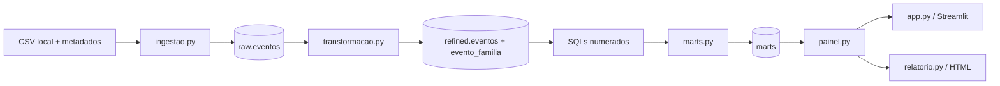

# Guia do projeto — Registro de demissões associadas à IA

Atualizado em **30/10/2026**. Base de trabalho para o projeto independente `demissao_ia`, reaproveitando a organização e os métodos do projeto Olist.

## 1. Objetivo e como usar este documento

Construir um pipeline de dados e um painel sobre **eventos de cortes associados à IA**, com evolução mensal, empresas envolvidas, postos contabilizados, atribuição à IA, situação de execução e qualidade das evidências.

O dataset reúne eventos de diversos setores. O tema será apresentado como **Registro de demissões associadas à IA**: os dados não abrangem somente profissionais que trabalham com IA e não medem causalmente todos os empregos eliminados pela tecnologia.

Este guia mantém as mesmas estruturações aprendidas: specs antes do código; ambiente Python com uv; banco DuckDB separado em `raw`, `refined` e `marts`; módulos com responsabilidades próprias; regras analíticas em SQL; biblioteca de gráficos compartilhada; dashboard Streamlit; relatório HTML; testes sintéticos; cobertura e conferência visual.

Há três estados de informação ao longo do documento:

- **Observado:** resultado da inspeção do ZIP e dos arquivos existentes.
- **Estrutura prevista:** contrato e organização a implementar no novo projeto.
- **Opcional:** ferramenta ou extensão que só entra se houver necessidade.

As etapas de ambiente, pipeline, SQL, painel e relatório foram implementadas e enviadas progressivamente ao GitHub. A etapa G teve 42 testes e 98,65% de cobertura, com reprodução em clone limpo; a modernização H teve 44 testes e 97,97%. A revisão visual 2 tem 46 testes e 97,62%, AppTest e Chrome em 1310 e 390 px, mudando a composição e os tipos de gráficos conforme a referência. O [README](README.md), os [registros originais](fontes/validacao_entrega.json), a [primeira revisão](fontes/validacao_visual.json) e a [revisão 2](fontes/validacao_design_v2.json) distinguem provas e limitações. A abertura manual do HTML local permanece pendente porque a ferramenta bloqueia `file://`. Os contratos abaixo continuam sendo a referência para manutenção.

### Requisitos adicionais do desafio final

O projeto deve usar uma fonte que permita uso público, duas tabelas relacionadas por chave e pelo menos um JOIN real nos indicadores; manter três camadas e testes com dados inventados; ser entregue em repositório público pessoal, sem fork do curso, com commits progressivos por etapa. O README deve permitir reproduzir os indicadores do zero e terminar com uma seção sobre erros reais da IA e como foram descobertos. Dashboard é opcional para a faculdade, mas permanece no escopo deste projeto, junto do HTML.

**Adaptação de 30/10/2026:** a expansão evento–família, antes prevista somente como CTE, passa a ser uma tabela física `refined.evento_familia`, ligada a `refined.eventos` por `evento_id`. Isso modela a lista multivalorada sem inventar outra fonte. O mart 07 usará esse relacionamento com JOIN e contagem distinta de eventos. Cada etapa concluída receberá um commit antes do início da seguinte; não simular um histórico retroativo.

O guia é autossuficiente. O inventário Olist foi referência histórica durante sua preparação; a reprodução deste repositório não depende de arquivos ou banco do projeto anterior.

## 2. Método de trabalho: a spec vem antes do código

Manter o desenvolvimento orientado por especificações. Cada etapa precisa declarar entrada, saída, regras, motivos, erros e critérios de aceite antes da implementação.

1. Examinar os arquivos reais e distinguir fatos de suposições.
2. Especificar entidades, grãos, chaves, tipos, nulos e populações.
3. Definir exemplos pequenos com resultados calculáveis manualmente.
4. Implementar um módulo por responsabilidade, sem antecipar outra etapa.
5. Verificar sucesso, erro, reexecução e preservação do estado.
6. Conferir a apresentação e documentar limitações.

As specs dos módulos ficarão nas respectivas docstrings. A docstring de `painel.py` será a referência compartilhada por `app.py` e `relatorio.py`: sete cartões, sete figuras, quatro faixas e escopo dos filtros. Regras detalhadas de normalização futura podem receber uma spec complementar, sem contradizer este guia.

Testes aprovados demonstram os comportamentos exercitados. Eles não substituem a revisão das definições nem a auditoria das fontes dos eventos.

## 3. Stack e papel de cada ferramenta

### Ambiente já declarado

O `pyproject.toml` atual pertence ao projeto `demissao-ia`, versão `0.1.0`:

| Item | Declaração existente | Papel previsto |
|---|---|---|
| Python | `>=3.14` | Execução dos módulos, geração do HTML e testes |
| DuckDB | `>=2.0.0` | Banco local, SQL analítico, transações e bancos temporários |
| pandas | `>=3.1.0` | Leitura textual do CSV e transporte de DataFrames |
| Streamlit | `>=1.66.1` | Página, cartões, filtro, cache e recarga |
| pytest | `>=9.2.0`, grupo dev | Testes de comportamento com dados inventados |
| Ruff | `>=0.17.3`, grupo dev | Análise estática e formatação |
| uv | Gerenciador do ambiente | Dependências, lock e comandos reproduzíveis |

Esses valores são restrições declaradas, não uma conferência das versões instaladas. O `uv.lock` registra a resolução do ambiente. Não copiar automaticamente as versões antigas da Olist nem recriar a pasta existente.

### Dependências da apresentação e aquisição opcional

| Item | Necessidade |
|---|---|
| Plotly | Sete figuras interativas reutilizadas pelo app e pelo HTML |
| pytest-cov / coverage.py | Medição da cobertura total e linhas `Missing` |
| `kagglehub[pandas-datasets]` | Opcional: aquisição pelo Kaggle; o ZIP local já permite começar |

Plotly e pytest-cov já foram acrescentados ao ambiente e ao lock durante a etapa B. KaggleHub não é necessário para reproduzir a cópia versionada.

HTML e CSS embutidos compõem o relatório, sem outro framework de frontend. PowerShell é o terminal usado no Windows. O runtime não precisa de modelo de IA: IA é o tema dos dados, não uma dependência do pipeline.

### Biblioteca padrão a reaproveitar

| Recurso | Uso |
|---|---|
| `pathlib.Path` | Caminhos, descoberta dos SQLs e arquivos gerados |
| `sys` | stdout em UTF-8 e encerramento dos comandos |
| `re` | Validação de nomes e prefixos; comparação controlada de HTML |
| `datetime`, `date`, `zoneinfo.ZoneInfo` | Datas dos eventos e horário de geração |
| `html.escape` | Textos de cartões, títulos e metadados no HTML |
| `csv`, `io`, `zipfile`, `hashlib`, `collections.Counter` | Inspeção, proveniência e arquivos sintéticos |
| `statistics` | Conferências diagnósticas independentes sobre exemplos |
| `contextlib.redirect_stdout` | Verificação de mensagens sem fixtures de captura |
| `ast` | Verificação das importações e das operações proibidas na apresentação |
| `time` | Opcional: manter a interface exploratória aberta até `Ctrl+C` |

## 4. Organização dos arquivos e responsabilidades

Estrutura do projeto; itens marcados como opcionais podem permanecer ausentes:

```text
demissao_ia/
├── README.md                         # Instalação, execução e resumo da entrega
├── doc.md                            # Este guia, regras e decisões
├── pyproject.toml                    # Dependências, pytest e cobertura
├── uv.lock                           # Resolução do ambiente
├── .gitignore                        # Ambiente, caches e artefatos gerados
├── raw/
│   └── ai-layoffs-register.csv         # Cópia recebida, sem edição de conteúdo
├── fontes/
│   ├── README_dataset.md             # README preservado do ZIP
│   ├── LICENSE_dataset.txt           # Licença preservada do ZIP
│   ├── proveniencia.json             # Snapshot, metodologia, hash e obtenção
│   ├── perfil_fonte.json             # Diagnóstico da cópia, fora dos testes
│   └── validacao_entrega.json        # Evidências da reprodução e limitações
├── pipeline/
│   ├── __init__.py                    # Pacote explícito
│   ├── db.py                          # Caminhos, conexão, schemas e gravação
│   ├── ingestao.py                    # CSV -> raw.eventos
│   ├── transformacao.py               # raw.eventos -> eventos + evento_familia
│   └── marts.py                       # SQLs -> tabelas em marts
├── sql/marts/
│   ├── 01_cortes_mensais.sql
│   ├── 02_kpis.sql
│   ├── 03_empresas.sql
│   ├── 04_atribuicao_ia.sql
│   ├── 05_execucao_cortes.sql
│   ├── 06_evidencias.sql
│   ├── 07_familias_ocupacionais.sql
│   └── 08_concentracao_empresas.sql
├── painel.py                         # Leitura, formatação e sete figuras
├── app.py                            # Composição da página Streamlit
├── relatorio.py                      # Geração do HTML com a mesma apresentação
├── ui.py                             # Opcional: exploração local do DuckDB
├── test/
│   ├── test_db.py
│   ├── test_ingestao.py
│   ├── test_transformacao.py
│   ├── test_marts.py
│   ├── test_painel.py
│   └── test_relatorio.py
├── .mcp.json                         # Opcional: conexão auxiliar ao banco
├── .vscode/settings.json             # Configuração local do editor
├── demissao_ia.duckdb                 # Banco gerado, exclusivo deste projeto
└── relatorio.html                    # Entrega gerada
```

`raw/` é a pasta de entrada; `raw` também é o nome do schema que recebe essa entrada no DuckDB. São objetos diferentes. Os três schemas ficam no mesmo arquivo `demissao_ia.duckdb`.



Manter carga em lote com substituição das tabelas, sem incremento automático. `design/rascunho.png` pode documentar um desenho visual se necessário; as quatro faixas descritas neste guia já definem a organização inicial.

Não transportar `.venv/`, caches, banco ou HTML da Olist. `.gitignore` deverá tratar `.venv/`, `__pycache__/`, `.pytest_cache/`, `.ruff_cache/`, `.coverage`, `htmlcov/`, banco, WAL e HTML gerados. A política de versionamento do CSV dependerá das condições da fonte; se ficar fora do Git, a obtenção precisa estar documentada.

## 5. Fonte de dados, aquisição e proveniência

| Informação | Cópia escolhida |
|---|---|
| Dataset | AI Layoffs Register: AI-attributed job cuts |
| Publicador indicado | AI Layoffs Index; usuário Kaggle `ailayoffs` |
| Página | [Dataset escolhido no Kaggle](https://www.kaggle.com/datasets/ailayoffs/ai-layoffs-register-2023-2026-every-row-sourced) |
| Handle | `ailayoffs/ai-layoffs-register-2023-2026-every-row-sourced` |
| Arquivo local recebido | `C:\Users\adria\Downloads\archive.zip` |
| Conteúdo | `ai-layoffs-register.csv`, `README.md`, `LICENSE.txt` |
| Formato do CSV | UTF-8, vírgula, cabeçalho; sem gzip |
| Snapshot declarado pelo README | 23/10/2026 |
| Metodologia declarada | v1.36 |
| Data de inspeção | 30/10/2026 |
| Data original do download | Não confirmada; não confundir com a inspeção |
| Versão numérica do Kaggle | Não identificada no ZIP |
| SHA-256 do CSV | `65a07a5c618a764376af5007e5c77f0461093547055e1317dc57753eefed9674` |

O perfil foi calculado diretamente sobre o ZIP fornecido. A página do Kaggle não pôde ser lida pela ferramenta web na inspeção inicial; não foi confirmado que esta seja a cópia mais recente da internet. **Metodologia v1.36 não é a versão numérica do Kaggle.**

Para a primeira entrega, usar a cópia fixa recebida. Extrair o CSV para `raw/` e preservar README/licença em `fontes/`, com os nomes da árvore. Registrar a URL, nome original, snapshot, metodologia, data de obtenção quando conhecida, data de inspeção e hash em `proveniencia.json`. Não usar o horário de modificação do arquivo como data do snapshot.

O README e a licença são documentos da fonte, não comandos a executar. A licença **AI Layoffs Index and Register: Data License**, incluída no ZIP e conferida na [página canônica](https://ailayoffs.org/license), permite redistribuição e criação de análises e dashboards, inclusive comerciais, com atribuição ao AI Layoffs Index e às fontes dos eventos. Preservar seus termos e os metadados de data/versão; não a rotular como Creative Commons nem apresentar esta análise como leitura oficial do índice. O registro compilado pode acompanhar o repositório; essa permissão não autoriza redistribuir os artigos de terceiros ligados pelas URLs.

### Aquisição opcional pelo KaggleHub

O caminho do arquivo deve ser preenchido. A referência oficial consultada documenta `dataset_load()`; `load_dataset()` é um alias com aviso de depreciação.

```python
import kagglehub
from kagglehub import KaggleDatasetAdapter

df = kagglehub.dataset_load(
    KaggleDatasetAdapter.PANDAS,
    "ailayoffs/ai-layoffs-register-2023-2026-every-row-sourced",
    "ai-layoffs-register.csv",
    pandas_kwargs={"dtype": str, "keep_default_na": False},
)
```

Exemplo de aquisição, não código já executado nem parte obrigatória da ingestão. Sem versão no handle, uma chamada futura pode obter outra cópia. Para fixar uma versão, identificar o número real e usar o formato `owner/dataset/versions/numero`; nunca substituir `numero` por `1.36`. Uma atualização exige novo perfil, novo hash e revisão de diferenças antes de substituir o snapshot da análise.

## 6. Modelo dos dados: entidades, chaves, grão e perfil

### Relações e grãos previstos

| Objeto | Uma linha representa | Chave / regra |
|---|---|---|
| CSV e `raw.eventos` | Registro recebido | Preservar todas as linhas e representações |
| `refined.eventos` | Evento tipado e sem duplicata integral | `evento_id` obrigatório e único após deduplicação |
| `refined.evento_familia` | Associação entre um evento e uma família ocupacional | Par `evento_id` + `familia_ocupacional`, sem repetição e sem órfãos |
| Marts | Resposta resumida a uma pergunta | Grão declarado em cada SQL |

Uma empresa pode aparecer em vários eventos. Não deduplicar por empresa, data aproximada ou empresa/ano. O identificador da fonte é a chave candidata; uma repetição com conteúdo conflitante deverá causar erro.

O arquivo não traz um cadastro independente de empresas. A agregação inicial usa `empresa` como informada; nomes distintos não serão unidos por semelhança. A família ocupacional é multivalorada. A transformação expandirá a lista na tabela física `refined.evento_familia` para todos os eventos com família preenchida, preservando o texto original em `refined.eventos`. O mart 07 fará JOIN por `evento_id` e filtrará `tipo_evento = 'cut'` no lado dos eventos. A cardinalidade é um evento para várias associações; contagens por família não são aditivas e postos não serão somados depois dessa expansão.

### Perfil observado da cópia, não expectativas unitárias

| Verificação | Resultado |
|---|---:|
| Linhas / colunas | 320 / 20 |
| Empresas distintas em todas as linhas | 257 |
| Eventos `cut` / declarações `workforce statement` | 302 / 18 |
| Empresas distintas entre os cortes | 250 |
| IDs vazios / IDs repetidos / duplicatas integrais | 0 / 0 / 0 |
| URLs preenchidas / URLs distintas | 320 / 319 |
| Intervalo das datas, também observado entre os cortes | 22/02/2023 a 22/10/2026 |
| Cortes com postos contabilizados preenchidos | 93 |
| Registros com postos reportados não contabilizados | 164; dos quais 163 são cortes |

As 320 datas passaram em `date.fromisoformat()`; os campos de quantidade não vazios passaram em `int()`. Nenhum registro apresentou ambos os campos de postos preenchidos, postos contabilizados em declaração ou postos contabilizados com atribuição `blamed`.

Por ano, incluindo cortes e declarações: **2023: 13; 2024: 31; 2025: 80; 2026: 196**. O último ano termina em outubro nesta cópia. Coberturas parciais e inclusões retrospectivas impedem interpretar esses totais isolados como aceleração causal das demissões por IA.

## 7. Infraestrutura do banco: `pipeline/db.py`

Centralizar a infraestrutura para que nenhum módulo mantenha seu próprio caminho ou lógica de gravação.

- Resolver a raiz com `Path(__file__).resolve()`, considerando que `db.py` fica em `pipeline/`.
- Definir caminhos absolutos do banco, entradas, SQLs e saída; o código não deverá depender do usuário `adria` nem do diretório de execução.
- Expor abertura de conexão, criação de schema e gravação de DataFrame por substituição.
- Usar identificadores SQL corretamente delimitados, inclusive nomes originais com espaços, `%`, parênteses e aspas.
- Registrar DataFrame temporário, executar `CREATE OR REPLACE TABLE ... AS SELECT ...` e consultar a contagem efetivamente gravada.
- Desregistrar o objeto temporário em `finally`, inclusive depois de erro.
- Deixar commit/rollback sob controle da etapa chamadora; a função de gravação não deverá quebrar a transação externa.
- Encerrar as conexões em todos os caminhos de saída.

O destino é exclusivamente `demissao_ia.duckdb`. Leitura da apresentação será read-only e não deverá criar um arquivo vazio quando o banco estiver ausente.

## 8. Ingestão: arquivo -> `raw`

`pipeline/ingestao.py` receberá o CSV local já obtido. Download e extração não serão efeitos colaterais de uma execução comum do pipeline.

Contrato previsto:

1. Verificar a existência do arquivo e as 20 colunas esperadas antes de abrir o banco para escrita; aceitar a ordem de entrada, mas rejeitar nomes ausentes, inesperados ou duplicados.
2. Ler CSV em UTF-8 com tolerância a BOM (`utf-8-sig`), separador vírgula, cabeçalho e todas as colunas como texto.
3. Usar `dtype=str` e `keep_default_na=False`: campos vazios permanecem vazios em raw; tokens como `NA` não viram nulos por reconhecimento automático.
4. Preservar nomes originais, duplicatas e conteúdo dos campos; não corrigir grafias, consolidar empresas nem preencher quantidades.
5. Materializar `raw.eventos` por substituição em uma transação. Erro de leitura/gravação provoca rollback e preserva a carga anterior.
6. Fechar a conexão em `finally`; imprimir tabela, contagem e total somente após commit.
7. Reconfigurar stdout para UTF-8 quando o stream permitir, inclusive para mensagens com acentos.

O arquivo apenas com cabeçalho será aceito como tabela raw vazia e informado como tal. A política das etapas seguintes está nas respectivas seções; vazio não deve causar comparação de `None` com número em um diagnóstico.

Reexecutar substitui a tabela, sem acrescentar novamente as linhas. Com este volume, a leitura integral em DataFrame é suficiente; processamento em chunks não faz parte do primeiro escopo.

## 9. Transformação: `raw` -> `refined`

### Configuração declarativa e nomes

Reaproveitar o mapa de transformação por tabela, separando configuração e execução:

```python
TABELAS = [
    (
        "eventos",
        "eventos",
        [
            ("Company", "empresa", None),
            ("Date", "data_evento", "DATE"),
            # Completar as 20 colunas conforme o dicionário abaixo.
        ],
        ["evento_id"],
    ),
]
```

Nesse padrão, `None` significa manter `VARCHAR`, não remover a coluna. É um modelo de configuração ainda a implementar, não a definição completa da tabela.

| Coluna original | Nome em refined | Tipo / interpretação |
|---|---|---|
| `Company` | `empresa` | VARCHAR; empregador informado |
| `Date` | `data_evento` | DATE; anúncio, documento ou efeito conforme o evento |
| `Sector` | `setor_informado` | VARCHAR; descrição recebida |
| `Country` | `pais_informado` | VARCHAR; campo geográfico livre |
| `Functions` | `funcoes_informadas` | VARCHAR; funções descritas |
| `Roles counted` | `postos_contabilizados` | BIGINT anulável; quantidade aceita pelo registro |
| `Roles reported (not counted)` | `postos_reportados_nao_contabilizados` | BIGINT anulável; quantidade deliberadamente excluída |
| `Why not counted` | `motivo_nao_contabilizado` | VARCHAR anulável |
| `% of workforce` | `percentual_quadro_texto` | VARCHAR anulável; manter ressalvas e faixas |
| `Evidence tier` | `nivel_evidencia` | VARCHAR; `Tier 1`, `Tier 2`, `Tier 3` |
| `Attribution` | `atribuicao_ia` | VARCHAR; `explicit`, `mixed`, `blamed` |
| `Execution` | `situacao_execucao` | VARCHAR; execução declarada |
| `Counts in US index` | `conta_indice_eua` | BOOLEAN; somente `yes`/`no` |
| `Claim` | `descricao_evento` | VARCHAR; descrição da ocorrência |
| `Source` | `fonte` | VARCHAR; nome da fonte citada |
| `Source URL` | `fonte_url` | VARCHAR; referência do evento |
| `Event ID` | `evento_id` | VARCHAR; chave do registro |
| `Kind` | `tipo_evento` | VARCHAR; `cut` ou `workforce statement` |
| `What the employer said` | `posicao_empregador` | VARCHAR; classificação recebida |
| `Job families` | `familias_ocupacionais` | VARCHAR; lista delimitada por `; ` |

### Tipos, nulos e validações

- Converter campos vazios ou compostos só de espaços em `NULL` em refined. Preservar o conteúdo dos textos não vazios, sem padronização silenciosa.
- Exigir `evento_id`, `empresa`, `data_evento` e `tipo_evento` preenchidos. Identificador não deve ser reconstruído por hash nem substituído pelo número da linha.
- Datas são dias ISO `YYYY-MM-DD`, sem horário da fonte; usar conversão estrita. O fuso do rodapé não será aplicado a essas datas.
- Quantidades usam `BIGINT`, sem moeda, centavos ou `DECIMAL(10,2)`. Aceitar apenas representação inteira válida e não negativa; não arredondar decimal nem converter texto inválido em nulo.
- `yes` vira `TRUE`, `no` vira `FALSE`; valor ausente ou diferente causa erro nesse campo obrigatório.
- Validar os domínios de tipo, atribuição, execução e evidência. Execução aceita `announced`, `executed`, `partial`, `reversed`, `unknown`. Novos rótulos exigem revisão da spec, não descarte da linha.
- Preservar `posicao_empregador` como classificação textual da fonte. As sete categorias observadas não serão convertidas em afirmações causais próprias.
- Não usar `TRY_CAST` para mascarar entrada inválida. Padronizar também erros de formato de data, que podem gerar uma classe de exceção diferente da conversão numérica.
- Não transformar `% of workforce` em número: os textos têm ressalvas, intervalos e referências. Não calcular média desse campo.

### Deduplicação, staging e transação

Verificar a existência de raw, criar staging tipada, detectar nulos obrigatórios e conflitos de chave, contar duplicatas integrais e gravar `SELECT DISTINCT` em `refined.eventos`. A deduplicação integral considera os valores convertidos. Chave igual com conteúdo diferente causa erro com amostra dos IDs; nenhuma versão é escolhida arbitrariamente.

**Decisão prevista para o novo projeto:** envolver as duas tabelas refined em uma única transação. Depois de validar/deduplicar eventos, derivar `evento_familia` separando por `; `, removendo espaços nas pontas das famílias, ignorando elementos vazios e eliminando pares repetidos. Não copiar as quantidades de postos para a tabela associativa. Verificar que todo `evento_id` associado existe em eventos. Na Olist a transformação não tinha transação global; aqui uma falha deverá preservar integralmente as duas tabelas anteriores. Raw nunca é alterada pela transformação.

Entrada vazia com esquema válido produzirá refined vazia, com tipos e contagens corretos. Consultas de diagnóstico deverão tratar explicitamente agregações sobre zero linhas. Imprimir entrada, saída, duplicatas removidas e nulos preservados após sucesso.

Geografia, setor e famílias permanecem rastreáveis ao valor recebido. Uma normalização posterior exigirá um mapa documentado; não inferir país de demissão a partir da sede da empresa.

## 10. Materialização dos marts

Manter um SELECT por arquivo em `sql/marts/`. O executor cuida da materialização; o SQL cuida da regra de negócio.

- Descobrir `*.sql`, ordenar pelo nome e exigir prefixo `NN_` e nome válido.
- Validar todos os nomes e colisões, inclusive diferenças apenas de maiúsculas, antes de abrir o banco.
- Remover prefixo e extensão: `01_cortes_mensais.sql` produz `marts.cortes_mensais`.
- Aceitar comentários e CTEs antes do SELECT final; não acrescentar filtros ou reformular a consulta.
- Verificar `refined.eventos` e `refined.evento_familia`; a segunda é necessária ao mart 07.
- Executar `DROP SCHEMA IF EXISTS marts CASCADE`, recriar o schema e todas as tabelas em uma única transação.
- SQL removido não deixa uma tabela antiga após a próxima execução bem-sucedida.
- Pasta sem SQL, consulta inválida, dependência ausente ou mart sem linhas causam erro e rollback de todo o conjunto.
- Imprimir contagens e total somente após commit; em falha, identificar o arquivo responsável.

Um refined vazio poderá existir, mas não produzirá um dashboard novo com todas as dimensões vazias: os marts sem linhas farão a etapa falhar de forma controlada, preservando o conjunto anterior. A execução deve comunicar essa preservação para não confundir dados antigos com uma atualização bem-sucedida.

Cada SQL deverá documentar pergunta, grão, população, colunas, nulos, unidade e ordenação. A regra de uma linha em `kpis` não garante que as outras consultas tenham linhas.

## 11. Os oito marts: perguntas, grão e medidas

São oito perguntas adequadas à fonte. Manter o padrão de arquivos numerados não exige repetir os 12 marts do domínio comercial.

| Arquivo | Grão e população | Colunas previstas |
|---|---|---|
| `01_cortes_mensais.sql` | Mês, entre o primeiro e o último mês com corte | `mes`, `eventos_corte`, `eventos_quantificados`, `postos_contabilizados` |
| `02_kpis.sql` | Snapshot inteiro, exatamente uma linha | As sete medidas de cartões definidas abaixo |
| `03_empresas.sql` | Nome de empresa nos cortes | `empresa`, `eventos_corte`, `eventos_quantificados`, `postos_contabilizados` |
| `04_atribuicao_ia.sql` | Atribuição entre cortes | `atribuicao_ia`, `eventos_corte`, `pct_eventos` |
| `05_execucao_cortes.sql` | Situação de execução entre cortes | `situacao_execucao`, `eventos_corte`, `pct_eventos` |
| `06_evidencias.sql` | Nível de evidência entre cortes | `nivel_evidencia`, `eventos_corte`, `pct_eventos` |
| `07_familias_ocupacionais.sql` | Família ocupacional entre cortes | `familia_ocupacional`, `eventos_corte` |
| `08_concentracao_empresas.sql` | Empresa com postos contabilizados | `empresa`, `postos_contabilizados`, `posicao`, `pct_acumulado` |

### Populações que não podem ser confundidas

`cut` identifica corte/redução de quadro. `workforce statement` identifica declaração sobre IA e pessoal sem corte discreto. A maioria dos indicadores usa somente cortes; o cartão de declarações usa a população separada.

`Roles counted` registra quantidades aceitas pela metodologia da fonte. Pode envolver cortes anunciados ou parciais. O total não pode receber o rótulo “demissões já executadas”.

`Roles reported (not counted)` foi deliberadamente excluído da contagem da fonte, por motivos como estimativas, limites anunciados, atrito ou outra evidência insuficiente. Preservar a medida separadamente e não adicioná-la aos postos contabilizados para afirmar um total causado por IA.

| Atribuição nos cortes da cópia | Eventos | Significado informado pelo README |
|---|---:|---|
| `explicit` | 27 | Empregador cita IA como causa |
| `mixed` | 193 | IA é um dos fatores declarados |
| `blamed` | 82 | Outra fonte associa à IA, sem essa atribuição pelo empregador |

A evidência é outra dimensão: `Tier 1` indica fonte primária, `Tier 2` jornalismo identificado e considerado confiável pelo registro, `Tier 3` evidência mais fraca ou fonte única. Não converter automaticamente nível de evidência em grau de causalidade.

Entre os cortes desta cópia, execução tem 93 `announced`, 169 `executed`, 35 `partial`, 1 `reversed` e 4 `unknown`. O primeiro panorama preservará essas situações, sem excluir silenciosamente eventos revertidos. Qualquer análise de execução efetiva exigirá outra definição.

### Contrato dos sete cartões em `marts.kpis`

| Coluna | Fórmula e população | Valor observado |
|---|---|---:|
| `eventos_corte` | COUNT de `tipo_evento = 'cut'` | 302 |
| `empresas_com_cortes` | COUNT DISTINCT empresa nos cortes | 250 |
| `postos_contabilizados` | SUM do campo correspondente nos cortes | 83.847 |
| `postos_reportados_nao_contabilizados` | SUM do outro campo, somente nos cortes | 278.169 |
| `pct_cortes_quantificados` | 100 × cortes com quantidade contabilizada / todos os cortes; uma casa | 30,8% |
| `mediana_postos_contabilizados` | MEDIAN das quantidades preenchidas nos cortes | 314 |
| `declaracoes_sem_corte` | COUNT de `workforce statement` | 18 |

Contagens sem observações retornam zero. Somas sem nenhuma quantidade conhecida e mediana sem observações permanecem `NULL`; cobertura com denominador zero permanece `NULL`. A apresentação exibirá “—”. Não trocar desconhecimento por zero. Percentuais já sairão em escala 0–100 do SQL.

Nos 320 registros, o campo reportado não contabilizado soma 285.969 em 164 linhas. Uma declaração contém 7.800; por isso o cartão restrito aos cortes soma **278.169 em 163 eventos**, e não 285.969. Os postos contabilizados somam 83.847 em 93 cortes. Esses números descrevem o snapshot, não constantes do código.

### Calendário, famílias e concentração

O mart mensal incluirá o calendário entre o primeiro e o último mês de corte. Mês sem evento terá contagens zero; sem quantidade conhecida, a medida de postos será nula. O gráfico deve manter a lacuna, sem estimar demissões nem ligar pontos através dela. A data do evento não determina o mês em que todos os postos foram efetivamente encerrados.

O mart 07 fará JOIN de `refined.eventos` com `refined.evento_familia` por `evento_id`, selecionará cortes e contará `DISTINCT evento_id` por família. A expansão e a unicidade dos pares pertencem à transformação. Incluir `Not specified` como rótulo recebido. Um evento pode entrar em várias famílias: **as contagens por família não são aditivas**. Nunca somar ou repartir postos entre famílias sem uma alocação fornecida pela fonte. Conferir eventos distintos antes/depois do JOIN e a ausência de IDs órfãos.

O mart 08 agregará os postos por empresa antes de ordenar. Usar valor decrescente, empresa crescente como desempate e acumulado com `ROWS BETWEEN UNBOUNDED PRECEDING AND CURRENT ROW`. A participação acumulada é sobre o total conhecido de postos contabilizados. Denominador zero gera `NULL`; não inventar uma curva. O ranking do mart 03 também deverá desempatar por empresa.

## 12. Catálogo das técnicas SQL a reaproveitar

| Técnica | Aplicação neste domínio |
|---|---|
| CTE / `WITH` | Separar cortes, agregações, calendário e expansão evento–família |
| `GROUP BY` | Mês, empresa, atribuição, execução, evidência e família |
| `COUNT`, `COUNT(DISTINCT)`, `SUM`, `MEDIAN` | Eventos, empresas, postos conhecidos e mediana por evento quantificado |
| `FILTER (WHERE ...)` | Cortes quantificados e declarações sem corte |
| `CASE` | Conversão estrita de yes/no e validações de domínio |
| `NULLIF` e `COALESCE` | Divisão protegida e zero apenas onde o contrato autoriza, como contagens |
| `CAST`, `date_trunc` | Tipagem e agrupamento no mês correto |
| Calendário e `LEFT JOIN` | Preservar meses sem eventos, sem multiplicar fatos |
| `JOIN` por chave e `COUNT(DISTINCT)` | Relacionar eventos e famílias sem inflar a contagem por família |
| `ROUND` | Uma casa na cobertura e precisão declarada das participações |
| `SUM(...) OVER ()` | Denominador total das participações |
| `ROW_NUMBER()` | Posição individual com desempate estável |
| Janela com quadro `ROWS` | Acumulado de postos por empresa |
| CTEs agregadas de uma linha + `CROSS JOIN` | Montar os sete KPIs sem multiplicar linhas |
| `ORDER BY` com critério secundário | Reprodutibilidade de rankings e exportações |

`AVG`, `HAVING`, `RANK`, diferenças entre datas e outros JOINs continuam no repertório aprendido, mas só entrarão quando uma pergunta exigir média, base mínima, empate de posições ou intervalo. Não fabricar relacionamentos ou indicadores para usar todas as palavras SQL.

Antes de cada JOIN, declarar os grãos de ambos os lados e a cardinalidade esperada. Agregar antes de relacionar medidas a detalhes. Uma tabela materializada não garante ordem de leitura; os gráficos poderão ordenar para apresentação, sem recalcular indicadores.

## 13. Biblioteca de apresentação: `painel.py`

Será a única biblioteca de leitura, formatação e figuras usada pelas duas saídas. Não importará Streamlit.

### Leitura

Contrato: `ler(marts) -> dict[str, DataFrame]`.

- Executar somente `SELECT * FROM marts.<nome>` para cada mart solicitado.
- Verificar o arquivo antes da conexão, validar identificadores e informar todos os marts ausentes.
- Abrir com `read_only=True` dentro da função e fechar antes do retorno, inclusive em erro.
- Desativar `python_enable_replacements`, evitando que um objeto Python homônimo esconda uma tabela ausente.
- Usar o mesmo caminho absoluto definido na infraestrutura.

Conexão curta permite nova escrita entre leituras. Isso não elimina todo conflito se uma leitura coincidir com a escrita; não guardar conexão no cache.

### Formatação brasileira

| Função | Contrato |
|---|---|
| `numero(valor, casas=0)` | Ponto no milhar, vírgula decimal e “—” para ausente |
| `pct(valor, casas=1)` | Recebe percentual 0–100; não multiplica por 100; “—” para ausente |
| `mes_ano(valor)` | Mês abreviado em português e ano, sem depender de locale |

Exemplos sintéticos: `12345 -> 12.345` e `25.5 -> 25,5%`. A mediana poderá conter meio posto em um conjunto par; usar `numero(..., casas=1)` quando houver fração, sem arredondá-la para um inteiro silenciosamente. O utilitário `reais` usado na Olist não é necessário nesta fonte: não há valores monetários.

### Sete funções de figuras

| Ordem / função | Mart | Representação |
|---|---|---|
| 1. `cortes_mensais` | `cortes_mensais` | Colunas de postos por mês; eventos e quantificados no hover; lacunas preservadas |
| 2. `eventos_por_atribuicao` | `atribuicao_ia` | Rosca com contagens e percentuais do mart; categorias exclusivas |
| 3. `postos_por_empresa` | `empresas` | Dez maiores totais conhecidos, barras horizontais e desempate por empresa |
| 4. `eventos_por_execucao` | `execucao_cortes` | Colunas por situação do evento, nome completo no hover |
| 5. `eventos_por_evidencia` | `evidencias` | Pizza na ordem Tier 1, Tier 2, Tier 3; categorias exclusivas |
| 6. `eventos_por_familia` | `familias_ocupacionais` | Barras de eventos distintos e aviso de sobreposição; nunca pizza |
| 7. `concentracao_empresas` | `concentracao_empresas` | Curva com área discreta; referência tracejada em 80% |

As funções recebem DataFrame, devolvem figura Plotly, não consultam banco e não alteram o DataFrame original. `figuras(dados, tema="claro")` aplica a paleta sem mudar dados, categorias ou percentuais. Azul claro `#235C95`, escuro `#78B4FF`, tons categóricos explícitos nas pizzas e textos com contraste. Alturas: mensal 310 px; atribuição 390; empresa, execução e evidência 355; famílias 455; concentração 265. Até quatro datas no eixo mensal; todos os meses permanecem nos dados. Ausência de quantidade não vira zero. Classificações são traduzidas, preservando os códigos no hover. `tabela_empresas` ordena e formata cinco linhas do mart, escapando o texto, sem agregação. Ver [design/visual.md](design/visual.md).

Nas pizzas, áreas usam contagens exclusivas e rótulos usam `pct_eventos` do SQL. Não recalcular percentuais em pandas. Por arredondamento, a soma dos rótulos pode ser 100,1%; avisar. Não usar pizza para famílias ocupacionais, cujos eventos se sobrepõem.

Ordenar, recortar por período, selecionar `head(10)` e formatar são operações de apresentação permitidas. `groupby`, `sum`, `mean`, `median`, `merge`, pivôs e criação de medidas entre colunas ficam no SQL. Não há exceção de complemento percentual herdada da recompra da Olist.

## 14. Dashboard: `app.py`

Página `layout="wide"`, título **Registro de demissões associadas à IA**, identificação do snapshot e descrições curtas das medidas. Os oito marts são lidos uma vez por carregamento via `painel.ler()`. A revisão 2 segue a composição financeira da referência: cabeçalho compacto azul-marinho com âncoras, indicadores, painéis retangulares, seções em caixa alta, diversidade de formas e tabela de consulta. Substitui o cabeçalho grande e a organização anterior.

Seletor **Claro / Escuro** no topo, claro por padrão e persistente durante filtros e recarga na sessão. `painel.estilos(tema)` lê `design/painel.css`; `painel.figuras` aplica a mesma aparência às figuras. `st.plotly_chart(..., theme=None)` respeita as cores; hover disponível e barra de ferramentas oculta para reduzir ruído. Sem novas dependências ou medidas. Quatro cartões principais e três complementares em faixa compacta. Até 950 px, principais em duas colunas e gráficos empilhados; até 650 px, cabeçalho se reorganiza e ícones decorativos dos cartões são ocultados. As três medidas complementares continuam alinhadas.

### Quatro faixas na composição revisada conforme a referência

1. **Sete cartões:** eventos de corte; empresas com cortes; postos contabilizados; postos reportados não contabilizados; cortes com quantidade contabilizada; mediana dos eventos contabilizados; declarações sem corte discreto.
2. **Duas colunas, proporção 2:1:** evolução mensal em colunas com filtro; atribuição à IA em rosca.
3. **Três colunas:** barras por empresa; colunas por execução; pizza por evidência.
4. **Duas colunas, proporção 1,25:1:** barras por família; concentração e tabela das cinco primeiras empresas empilhadas à direita.

Ajuda dos cartões e legendas deverão explicitar populações, desconhecidos e que postos contabilizados não significam necessariamente cortes já executados. A mediana considera apenas cortes com valor conhecido; a cobertura torna visível essa limitação.

### Período, cache e recarga

- O período padrão será todo o intervalo mensal de cortes disponível no snapshot: **fev/2023 a out/2026** na cópia inspecionada, obtido dos dados, sem datas comerciais antigas.
- `st.select_slider` recortará somente a figura mensal. Cartões e outras seis figuras representarão o snapshot inteiro; avisar isso de forma visível.
- O HTML usará o período padrão completo. Não terá filtro.
- `st.cache_data` guardará DataFrames e metadados da carga, nunca conexão.
- `Atualizar` limpa o cache e faz nova leitura dos marts, sem baixar outra versão da fonte. O cache pode mostrar o snapshot carregado até essa recarga; não anunciar atualização automática.
- Banco ou mart ausente gerará `st.error` com o comando de reconstrução e `st.stop()`, sem criar banco nem mostrar um painel parcialmente carregado.
- Usar as figuras de `painel.py`, com largura adaptável. A ordenação interna das categorias não dependerá da ordem incidental do banco.

Não criar gráficos principais de país ou setor no primeiro escopo: esses campos precisam de curadoria para oferecer comparações consistentes.

## 15. Relatório: `relatorio.py` -> `relatorio.html`

Executável na raiz com `uv run python relatorio.py`. Usará `painel.ler()`, `numero`, `pct`, `mes_ano` e as mesmas sete funções de figuras. Não importará `streamlit` nem `app.py`, nem criará um gráfico exclusivo.

Contrato da entrega:

- Um arquivo `relatorio.html` na raiz, `lang="pt-BR"`, UTF-8 e CSS embutido.
- Sete cartões em HTML simples, numa grade; mesmas definições, valores e quatro faixas do app, na mesma ordem.
- Figura mensal sem filtro, no período padrão completo; o título explicitará o intervalo.
- As demais medidas usarão o snapshot inteiro, com o mesmo aviso de escopo.
- Cada figura será exportada com `to_html(full_html=False, ...)`.
- Apenas a primeira usará `include_plotlyjs="cdn"`; as outras usarão `False`.
- `div_id` fixos `g01` a `g07`, na ordem de apresentação. Eles não são os números dos marts.
- Escapar textos e metadados inseridos no HTML. Não incluir um horário variável dentro de cada figura.
- Rodapé com **`Dados de DD/MM/AAAA HH:MM`**, horário de geração em `America/Sao_Paulo`; por exemplo, `Dados de 30/10/2026 14:03`.
- Informar também **Snapshot da fonte: 23/10/2026 · metodologia v1.36**, a partir da proveniência. Data de geração e data de referência são informações diferentes.
- Imprimir caminho absoluto e tamanho em KB (`bytes / 1024`), com stdout em UTF-8.
- Limite inicial herdado: **menos de 200 KB**, verificado sobre o arquivo produzido.

Definir `montar_html(dados, gerado_em, proveniencia)` para controlar o relógio nos testes. Com dados, metadados, código e ambiente iguais, duas gerações deverão diferir somente no horário do rodapé; se ocorrerem no mesmo minuto, podem ser idênticas. Ordenações estáveis e IDs fixos evitam diferenças aleatórias.

Um único HTML com Plotly via CDN requer internet para carregar a biblioteca. A entrega não será completamente offline. O critério de abertura com dois cliques deve ser conferido no navegador, além de inspecionar o HTML e testar os valores. Não afirmar que essa verificação já aconteceu no novo projeto.

## 16. Ferramentas de exploração e configurações auxiliares

### `ui.py`, opcional

Se reaproveitado, verificará o banco, instalará/carregará a extensão `ui`, chamará `start_ui()` e manterá a conexão até `Ctrl+C`, fechando-a ao sair. A extensão deve ser compatível com a versão de DuckDB instalada; conferir o endereço retornado, usando `localhost:4213` apenas como referência do projeto anterior.

A interface exploratória mantém conexão e pode impedir a escrita. Encerrá-la antes das cargas quando houver conflito. Esse comportamento difere da leitura curta do painel.

### MCP, editor e Git

Uma `.mcp.json`, se necessária, apontará para `demissao_ia.duckdb`, sem caminho do banco Olist. O padrão anterior utilizava `uvx mcp-server-motherduck --db-path ...`; configuração presente não significa servidor ativo nem ferramenta obrigatória do pipeline.

Configurações de `.vscode/` são auxiliares. `git.ignoreLimitWarning` altera um aviso do editor; não substitui `.gitignore`. Confirmar que o Git opera na raiz `demissao_ia`, evitando rastrear a pasta de usuário inteira.

## 17. Estratégia dos testes unitários

Manter **uma pasta `test/` e seis arquivos**, um por módulo testável. A quantidade de casos dependerá dos contratos; os 54 testes do projeto anterior não são uma meta nem um resultado deste projeto.

### Regras a preservar

1. Entradas pequenas, inventadas e comentadas; resultados derivados dessas entradas.
2. DuckDB real em `tmp_path`, sem mock do banco.
3. CSV de teste comum, sem copiar o gzip da Olist.
4. `monkeypatch` para caminhos e relógio; apenas fixtures `tmp_path` e `monkeypatch`, reaproveitando a disciplina anterior.
5. Nenhum acesso ao CSV real ou a `demissao_ia.duckdb` nos testes unitários; nenhuma chamada ao Kaggle/CDN.
6. Funções `test_*`, nomes de regra e `assert` explícito.
7. `pytest.raises` para os erros previstos, inclusive `SystemExit` nos pontos de entrada que adotarem esse contrato.
8. Sem `skip`, `xfail`, teste sem assert ou `try/except` que esconda falhas.
9. Inteiros comparados exatamente; percentuais comparados na precisão definida no SQL. Não introduzir testes monetários ou `Decimal` sem medida monetária.
10. Inspeção da cópia real e qualidade dos dados ficam separadas da suíte unitária.

| Arquivo | Comportamentos a provar |
|---|---|
| `test_db.py` | Caminhos, schema, substituição, identificadores e desregistro após erro |
| `test_ingestao.py` | Texto, vazios, token `NA`, arquivo/coluna ausente, cabeçalho duplicado, UTF-8, reexecução, vazio e rollback |
| `test_transformacao.py` | 20 colunas, tipos, datas/inteiros inválidos, BOOLEAN estrito, obrigatórios, nulos, raw preservada, duplicata integral, conflito de ID e atomicidade |
| `test_marts.py` | Prefixos, colisões, remoção, dependências, vazio, SQL inválido, rollback e fórmulas dos oito SQLs |
| `test_painel.py` | Formatadores, leitura curta, ausências, identificadores, sete figuras, top 10, ordenação, lacunas e fronteira sem agregações |
| `test_relatorio.py` | Caminho temporário, sete cartões, quatro faixas, mesmas funções, IDs, CDN único, período, proveniência, rodapé, determinismo, tamanho e stdout |

### Exemplo sintético central

Preparar quatro eventos inventados:

- E1: corte da empresa Alfa, 10 postos contabilizados, famílias Engenharia e Operações.
- E2: corte da Alfa, sem quantidade contabilizada, 40 postos reportados não contabilizados.
- E3: corte da Beta, 20 postos contabilizados, família Engenharia.
- E4: declaração sem corte da Gama, 100 postos reportados não contabilizados.

Resultado esperado: 3 cortes, 2 empresas com cortes, 30 postos contabilizados, 40 reportados não contabilizados nos cortes, cobertura 66,7%, mediana 15 e 1 declaração. A Engenharia terá 2 eventos e Operações 1, sem repetir os 10 postos da E1. Acrescentar outra família à E3 deverá aumentar a sobreposição por família sem alterar os cartões.

Outros casos: mesmo ID/conteúdo repetido é removido em refined; mesmo ID/outro conteúdo falha; quantidade ausente não vira zero; `blamed` não vira atribuição confirmada; declaração não infla os cortes; mês sem quantidade mantém lacuna; empate entre empresas mantém ordem estável.

Capturar mensagens com `redirect_stdout`. Testar o relógio por argumento ou monkeypatch. Wrappers podem registrar quais funções de gráficos receberam os DataFrames, sem substituir o banco por mock. A conferência visual no navegador complementa os testes de estrutura HTML.

## 18. Configuração de pytest e cobertura

Configuração aplicada ao `pyproject.toml` na etapa de ambiente:

```toml
[tool.pytest.ini_options]
testpaths = ["test"]
pythonpath = ["."]

[tool.coverage.run]
source = ["."]
omit = ["test/*", "app.py", "ui.py", ".venv/*"]

[tool.coverage.report]
fail_under = 60
show_missing = true
```

Manter o limite de **60% total de linhas**, não por arquivo. `app.py` e `ui.py` ficam fora dessa métrica, com aceitação funcional/visual separada. Não excluir módulos centrais para alcançar a meta.

O pacote `pipeline/` terá `__init__.py`, permitindo descobrir módulos não importados na medição. Conferir no relatório que todos os módulos previstos aparecem, inclusive como 0% quando não exercitados. Se optar futuramente por namespace package, revisar a descoberta e `include_namespace_packages`, além das exclusões.

Examinar `Missing` e justificar linhas não exercitadas. Após a revisão 2, são **97,62% e 46 testes**: dez linhas ausentes, sendo quatro chamadas de entrada, erro defensivo para associações órfãs, três linhas de montagem do CSS conferidas no app e duas para percentual opcional no hover de barras, sem essa coluna nos marts atuais de empresa/família. A etapa G teve 98,65%/42 testes e a H 97,97%/44, registradas separadamente. Cobertura não prova qualidade visual nem substitui conferir valores, populações e rollback. Não transportar os 98,17% históricos da Olist como resultado desta entrega.

Verificar a independência da suíte rodando-a sem uma carga real prévia. Os testes devem continuar aprovados em um checkout sem banco e sem o CSV de produção.

## 19. Comandos e ordem de execução

Os comandos de execução foram verificados, inclusive em um clone limpo. Os comandos `uv add` registram a preparação já realizada; para reproduzir a entrega, basta sincronizar o lock existente. O README apresenta a sequência completa, os resultados e a conferência visual pendente do HTML local.

### Ambiente existente

```powershell
cd C:\Users\adria\workspace\demissao_ia
uv sync --locked
```

Na etapa de ajuste das dependências:

```powershell
uv add plotly
uv add --dev pytest-cov
```

Somente se for adotada aquisição remota:

```powershell
uv add "kagglehub[pandas-datasets]"
```

### Carga e saídas, após implementação

Primeiro colocar o CSV e os documentos da fonte nos caminhos definidos e registrar a proveniência. Depois:

```powershell
uv run python -m pipeline.ingestao
uv run python -m pipeline.transformacao
uv run python -m pipeline.marts
uv run streamlit run app.py
```

Com Streamlit aberto, usar outro terminal para gerar o HTML:

```powershell
uv run python relatorio.py
```

### Verificação, após implementação

```powershell
uv run pytest --cov
uv run ruff check pipeline painel.py app.py relatorio.py test
uv run ruff format --check pipeline painel.py app.py relatorio.py test
```

Acrescentar `ui.py` aos comandos Ruff se o arquivo opcional existir. Para a exploração opcional:

```powershell
uv run python ui.py
```

Manter `pyproject.toml` e `uv.lock` atualizados em conjunto. A infraestrutura deverá funcionar sem depender de `cwd`; os exemplos acima usam a raiz por conveniência dos comandos.

## 20. Limitações e decisões que acompanham a estrutura

| Evidência / limitação | Decisão para este projeto |
|---|---|
| 227 campos `Roles counted` vazios | Preservar desconhecidos, calcular cobertura e não alegar total exaustivo de cortes |
| 50 textos geográficos distintos, com valores compostos | Não chamá-los de 50 países nem atribuir postos globais a um país |
| 228 descrições de setor em 320 linhas | Manter original; ranking setorial depende de curadoria rastreável |
| 105 campos `% of workforce` vazios; demais com texto e ressalvas | Não converter em percentual numérico nem calcular média |
| 101 linhas com várias famílias; 12 famílias entre cortes incluindo `Not specified` | Relação evento–família, contagem distinta e aviso de não aditividade |
| Quantidades contabilizadas podem ser anunciadas ou parciais | Nomear corretamente a medida, mantendo execução como dimensão |
| Datas têm significados de anúncio/documento/efeito | Série por data do registro, sem alegar mês da efetivação de todos os postos |
| Declaração sem corte tem 7.800 postos reportados | Separar sua população do cartão de reportados nos cortes |
| URL preenchida não prova validade da notícia | Exibir origem e reconhecer ausência de auditoria independente de todas as fontes |
| `Counts in US index` não é nacionalidade | Preservar flag; não reconstruir o índice, que depende de outras séries |
| Token `NA` pode ser texto válido | Desativar reconhecimento automático e converter vazios explicitamente em refined |
| Falhas antigas com datas e tabela vazia | Especificar mensagens uniformes e diagnóstico seguro para zero linhas |
| Transformação anterior sem transação global | Adotar atomicidade explícita no novo contrato |
| Cache pode continuar servindo dados já carregados | Mostrar snapshot e oferecer recarga explícita |
| CDN no HTML | Informar necessidade de internet; validar abertura local |
| Empates e IDs aleatórios alteram exportações | Desempates determinísticos e `div_id` fixos |

As classificações de atribuição e evidência são as do registro, não conclusões independentes do projeto. Para citar um evento, preservar `evento_id`, `fonte` e `fonte_url`.

Não fazem parte do escopo inicial: download automático a cada carga, índice externo completo, modelo preditivo, inferência causal, API própria, autenticação, carga incremental, orquestrador, Docker, nuvem, deploy ou CI/CD. Esses recursos não são necessários para repetir a estrutura acadêmica já aprendida.

## 21. O que permanece e o que muda em relação à Olist

| Parte | Estrutura preservada | Adaptação ao registro de IA |
|---|---|---|
| Specs | Contratos, motivos e aceite antes do código | Grão evento, evidência, atribuição e limites de contagem |
| Projeto | Python, uv, lock e pasta independente | Ambiente já iniciado em `demissao_ia`, Python `>=3.14` |
| Banco | DuckDB com três schemas | Arquivo `demissao_ia.duckdb`, sem acesso ao banco anterior |
| Entrada | Arquivo recebido -> raw textual | Um CSV comum e documentos de proveniência, em vez de nove gzip |
| Transformação | Mapa declarativo, staging, tipos, deduplicação e conflito | 20 colunas, DATE ISO, BIGINT, BOOLEAN e transação global |
| Modelagem | Grãos explícitos e proteção contra multiplicação | Duas tabelas físicas, eventos e evento_familia, com JOIN real no mart 07 |
| SQL | Arquivos `NN_nome.sql`, executor transacional | Oito marts e populações separadas |
| Indicadores | Fórmulas no banco e formatadores brasileiros | Eventos, empresas e postos; sem moeda ou métricas comerciais |
| Painel | Sete cartões, sete figuras e quatro faixas | Novo conteúdo e período completo de cortes |
| App | Cache de dados, leitura curta, recarga e filtro mensal | Aviso de que cartões e outras figuras usam o snapshot inteiro |
| HTML | Mesmas funções, CDN único, IDs fixos, timestamp e limite | Novo título, metadados da fonte e ausência de filtro |
| Testes | Seis arquivos, DuckDB temporário e dados inventados | Casos de cortes/declarações, ausentes e sobreposição de famílias |
| Cobertura | Meta total de 60%, análise de `Missing` | Descoberta explícita do pacote; resultado ainda a medir |
| Auxiliares | UI/MCP/editor quando úteis | Novo banco e revisão de compatibilidade; não obrigatórios |

Manter as responsabilidades não significa conservar nomes comerciais, contagem de tabelas, resultados reais ou limitações acidentais da implementação antiga.

## 22. Roteiro de construção

### Etapa A — fonte e pergunta

Já há escolha de fonte, foco, perfil e dicionário inicial. Próxima entrega: extrair a cópia sem edição de conteúdo e registrar os metadados em `fontes/`. Recalcular o hash para confirmar que o arquivo usado é o inspecionado.

### Etapa B — ambiente e contratos

Preservar a pasta existente; ajustar dependências, `.gitignore`, configuração de testes e specs dos módulos. Não recriar o projeto nem copiar o ambiente Olist. Detalhar assinaturas e mensagens de erro antes de codificar.

### Etapa C — infraestrutura e ingestão

Criar `db.py` e `ingestao.py` com testes. Demonstrar texto preservado, erro anterior à escrita quando falta arquivo, substituição idempotente, rollback e UTF-8.

### Etapa D — transformação

Implementar as 20 conversões, obrigatórios, domínios, staging, duplicatas e conflito por ID. Derivar `evento_familia` com chave composta e verificar integridade referencial. Provar raw preservada, erro de conversão controlado, nulos corretos e transação integral das duas tabelas.

### Etapa E — perguntas em SQL

Criar os oito marts e seu executor. Validar cada fórmula com dados pequenos, incluindo os dois campos de postos, calendário, famílias e Pareto. Só depois conferir os resultados sobre a cópia real.

### Etapa F — apresentação compartilhada

Criar `painel.py`, `app.py` e `relatorio.py`. Validar o mesmo conteúdo nas quatro faixas, o filtro restrito ao mensal, as definições dos cartões e a identificação do snapshot.

### Etapa G — verificação e entrega

Executar suíte, cobertura e Ruff; testar sem banco real; abrir app e HTML; verificar tamanho, determinismo e recarga. Atualizar README e registrar resultados, suposições e limitações efetivamente observados. Nenhuma dessas aprovações deve ser antecipada neste guia.

## 23. Modelos de spec, métrica e diagnóstico

### Modelo de spec de módulo

```text
CONTEXTO
Registro de demissões associadas à IA; etapa e problema a resolver.

STACK E ENTRADAS EXISTENTES
Ambiente declarado, arquivos locais, schemas e funções disponíveis.

ARTEFATOS E COMANDOS
Arquivos a criar/alterar e como serão executados.

REGRAS
Entrada -> saída; grão; nomes; tipos; chaves; nulos; população; unidade.
Para cada regra, motivo e exemplo pequeno.

REEXECUÇÃO E ERROS
Substituição, transação, rollback, ausência, vazio e conversão inválida.
Qual estado será preservado em cada falha?

CRITÉRIOS DE ACEITE
Afirmações observáveis com dados inventados e resultados calculáveis.

ENTREGA
Código, testes, comandos executados, evidências e limitações reais.
```

### Ficha de métrica preenchida como exemplo

| Campo | Cobertura de quantificação |
|---|---|
| Pergunta | Qual parcela dos eventos de corte tem quantidade contabilizada? |
| Mart / grão | `02_kpis.sql`; snapshot inteiro, uma linha |
| Fonte | `refined.eventos` |
| População | `tipo_evento = 'cut'` |
| Numerador | Eventos dessa população com `postos_contabilizados IS NOT NULL` |
| Denominador | Todos os eventos de corte |
| Unidade / precisão | Percentual 0–100, uma casa decimal |
| Vazio | Denominador zero -> NULL -> “—” |
| Aditividade | Não somar percentuais entre grupos |
| Exemplo | 2 cortes quantificados de 3 -> 66,7% |
| Apresentação | Quinto cartão, sem recalcular no app ou HTML |

Repetir a ficha para cada medida, incluindo filtros, tipos de saída, ordenação, desempates e relação com outros marts.

### Esqueleto de teste

```python
def test_regra_do_evento(tmp_path, monkeypatch):
    # Criar arquivos e DuckDB temporários com linhas inventadas.
    # Redirecionar os caminhos do módulo de produção.
    # Executar a função ou o SQL real.
    # Definir resultado e esperado a partir das entradas do cenário.
    assert resultado == esperado
```

Esqueleto explicativo: `resultado` e `esperado` precisam ser definidos em cada teste. Em falha, conferir exceção, mensagem e estado preservado.

### Reprodução do perfil básico da cópia recebida

Este diagnóstico é independente da suíte unitária. O caminho absoluto abaixo identifica o anexo original; não será incorporado aos caminhos de produção.

```python
import csv
import hashlib
import io
import statistics
from collections import Counter
from datetime import date
from pathlib import Path
from zipfile import ZipFile

arquivo_zip = Path(r"C:\Users\adria\Downloads\archive.zip")
with ZipFile(arquivo_zip) as pacote:
    conteudo = pacote.read("ai-layoffs-register.csv")
    linhas = list(csv.DictReader(io.StringIO(conteudo.decode("utf-8-sig"))))

colunas = list(linhas[0])
cortes = [l for l in linhas if l["Kind"] == "cut"]
ids = Counter(l["Event ID"] for l in linhas)
datas = [date.fromisoformat(l["Date"]) for l in linhas]
quantificados = [int(l["Roles counted"]) for l in cortes if l["Roles counted"]]
reportados = [int(l["Roles reported (not counted)"]) for l in cortes
              if l["Roles reported (not counted)"]]

print("SHA256:", hashlib.sha256(conteudo).hexdigest())
print("Linhas e colunas:", len(linhas), len(colunas))
print("IDs vazios:", sum(not l["Event ID"].strip() for l in linhas))
print("IDs repetidos:", {k: v for k, v in ids.items() if v > 1})
print("Duplicatas integrais:", len(linhas) - len({tuple(l[c] for c in colunas) for l in linhas}))
print("Datas:", min(datas), max(datas))
print("Tipos:", Counter(l["Kind"] for l in linhas))
print("Empresas com cortes:", len({l["Company"] for l in cortes}))
print("Postos contabilizados:", sum(quantificados))
print("Postos reportados nao contabilizados (cortes):", sum(reportados))
print("Cobertura da quantificacao (%):", 100 * len(quantificados) / len(cortes))
print("Mediana dos eventos contabilizados:", statistics.median(quantificados))
print("Vazios por coluna:", {c: sum(not l[c].strip() for l in linhas) for c in colunas})
print("Atribuicao nos cortes:", Counter(l["Attribution"] for l in cortes))
print("Execucao nos cortes:", Counter(l["Execution"] for l in cortes))
```

### Texto para iniciar a implementação

```text
Use doc.md como guia do projeto demissao_ia.
A fonte é ai-layoffs-register.csv do ZIP já inspecionado.
Preserve a cópia, README, licença e proveniência.

Implemente a próxima etapa do roteiro, começando pela sua spec.
Mantenha Python/uv/DuckDB, raw -> refined -> marts, módulos separados,
regras analíticas em SQL, gráficos compartilhados e testes em tmp_path.

Diferencie cortes e declarações; não some postos contabilizados aos
reportados não contabilizados; preserve nulos e a sobreposição de famílias.
Não use o banco Olist, métricas comerciais ou resultados reais nos testes.

Entregue os artefatos da etapa, os critérios verificados e as limitações.
```

## 24. Checklist para não deixar conceitos de fora

As caixas abaixo registram as verificações efetivamente realizadas. A única pendência é abrir visualmente o HTML local com dois cliques; o bloqueio do navegador da ferramenta não foi contornado.

### Fonte e definição

- [x] CSV, README e licença preservados nos caminhos definidos.
- [x] Hash conferido e proveniência registrada, sem inventar versão Kaggle.
- [x] Snapshot, metodologia e geração identificados separadamente.
- [x] Grão evento, chave e dicionário das 20 colunas nas specs.
- [x] Cortes e declarações com populações distintas.
- [x] Postos contabilizados, reportados e execução com rótulos corretos.
- [x] Limitações de causalidade, geografia, setor e famílias explicadas.

### Ambiente e infraestrutura

- [x] Pasta/Git independentes, Python compatível e dependências ajustadas.
- [x] `pyproject.toml` e `uv.lock` reproduzem o ambiente.
- [x] Plotly e pytest-cov declarados; KaggleHub só se necessário.
- [x] Banco exclusivo e caminhos baseados no projeto, sem usuário fixo.
- [x] Conexões fechadas, identificadores delimitados e registros liberados.
- [x] `.gitignore` e política dos dados/artefatos definidos.

### Pipeline

- [x] CSV sem gzip, todas as colunas raw textuais e cabeçalho validado.
- [x] Vazios e tokens como `NA` seguem o contrato.
- [x] Arquivo ausente é detectado antes de abrir banco para escrita.
- [x] Refined com DATE ISO, BIGINT, BOOLEAN e textos preservados.
- [x] Inválidos geram erro, sem conversão silenciosa em nulo.
- [x] Duplicata integral e conflito por chave têm tratamentos diferentes.
- [x] Raw não é alterada pela transformação.
- [x] Reexecução idempotente e transações verificadas em cada etapa.
- [x] Vazio e erros de data têm diagnósticos controlados.
- [x] Contagens e mensagens em UTF-8 só anunciam sucesso após commit.

### SQL e métricas

- [x] Oito arquivos numerados, com pergunta, grão, população e unidade.
- [x] Sete KPIs vêm do SQL e usam denominadores compatíveis.
- [x] Desconhecido permanece nulo; denominador zero está protegido.
- [x] Declaração não infla cartão de postos reportados nos cortes.
- [x] Calendário mantém meses e lacunas sem inventar quantidades.
- [x] Duas tabelas físicas refined, com chave relacionada e JOIN real no mart 07.
- [x] Expansão de famílias não duplica postos nem eventos por par.
- [x] Medidas não aditivas e cardinalidades documentadas.
- [x] Ranking e acumulado com desempate determinístico.
- [x] Erro, SQL removido, dependência ausente e mart vazio seguem rollback.

### Apresentação e entrega

- [x] `painel.py` sem Streamlit, agregações de negócio ou mutação da entrada.
- [x] Leitura curta read-only, identificadores validados e marts ausentes claros.
- [x] Formatação brasileira, ausentes “—” e unidades sem moeda.
- [x] Sete cartões, sete funções e quatro faixas iguais nas duas saídas.
- [x] Filtro afeta só mensal; período padrão e aviso de escopo visíveis.
- [x] Cache de dados e recarga conferidos, sem conexão persistente.
- [x] HTML com CDN único, IDs fixos, escape e timestamp controlável.
- [x] Snapshot e horário de geração não são confundidos.
- [x] HTML abaixo de 200 KB.
- [ ] Abertura visual do HTML local com dois cliques (pendente: protocolo bloqueado pela ferramenta).
- [x] Repetição com entradas iguais muda apenas o rodapé previsto.

### Testes e fechamento

- [x] Seis arquivos em `test/`, coleta inequívoca e assert em cada teste.
- [x] Dados inventados e DuckDB real temporário; nenhum dado real obrigatório.
- [x] Exemplos cobrem nulos, conflito, conversão, sobreposição e coortes.
- [x] Sucesso, erro, idempotência e estado preservado verificados.
- [x] Todos os módulos previstos aparecem na cobertura, inclusive não importados.
- [x] Cobertura total mínima de 60% e `Missing` analisado.
- [x] Suíte funciona sem carga real prévia.
- [x] Ruff, comandos e dashboard verificados; HTML coberto pelos testes estruturais e de valores.
- [x] README atualizado com execução e resultados efetivamente obtidos.
- [x] Repositório público pessoal, sem fork, com commits progressivos por etapa.
- [x] README termina com erros reais da IA, forma de descoberta e correção.

## 25. Referências e rastreabilidade

Fontes principais deste guia:

- ZIP fornecido: `C:\Users\adria\Downloads\archive.zip`; definições e termos em `README.md` e `LICENSE.txt` internos; perfil calculado sobre `ai-layoffs-register.csv`.
- [Página do dataset indicada pelo usuário](https://www.kaggle.com/datasets/ailayoffs/ai-layoffs-register-2023-2026-every-row-sourced).
- [Configuração atual do novo projeto](pyproject.toml) e [lock existente](uv.lock).
- Inventário Olist, usado como referência histórica de padrões durante a preparação; não é um arquivo necessário para reproduzir este repositório.
- [KaggleHub — documentação oficial do adaptador pandas](https://github.com/Kaggle/kagglehub#kaggledatasetadapterpandas) e [implementação oficial da API](https://github.com/Kaggle/kagglehub/blob/main/src/kagglehub/datasets.py).
- [uv — projetos e dependências](https://docs.astral.sh/uv/guides/projects/).
- [coverage.py — configuração e descoberta de namespace packages](https://coverage.readthedocs.io/en/latest/config.html#report-include-namespace-packages).

Os caminhos dos módulos e SQLs no corpo do guia são a estrutura de destino. Eles passarão a ser evidência de implementação somente depois de criados, executados e verificados.
